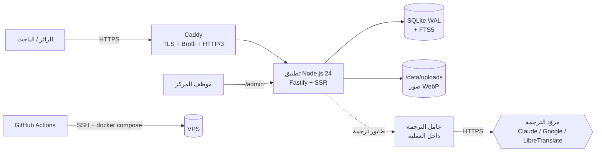

# المعمارية التقنية (Architecture)

## 1. نظرة عامة



**قرار جوهري:** تطبيق واحد بعملية واحدة وقاعدة بيانات ملف واحد. حجم المحتوى (آلاف العناصر) والزيارات المتوقعة لا تحتاج مجموعة خوادم، والبساطة تعني صيانة أرخص وأقل أعطالاً.

## 2. التقنيات والاعتماديات

| الطبقة | الاختيار | السبب |
|---|---|---|
| وقت التشغيل | **Node.js 24 LTS** | `node:sqlite` مدمج مع FTS5، تشغيل TypeScript مباشرة بلا خطوة بناء، `node:test` |
| اللغة | **TypeScript** (حذف الأنواع الأصلي + `tsc --noEmit` للفحص) | أمان الأنواع دون أدوات بناء للخادم |
| الإطار | **Fastify 5** | أداء، مخططات تحقق، نظام إضافات ناضج، `inject()` للاختبار |
| قاعدة البيانات | **SQLite (WAL) + FTS5** عبر `node:sqlite` | لا خادم قاعدة بيانات، نسخ احتياطي بملف، قراءات سريعة جداً |
| القوالب | قوالب TypeScript بوسم `html` يهرّب تلقائياً | أمان XSS افتراضي، بلا محرك قوالب |
| التعقيم | `sanitize-html` | قائمة بيضاء صارمة لمحتوى HTML الوارد |
| الصور | `sharp` | تحويل WebP/AVIF بأحجام متعددة |
| الواجهة | CSS حديث (طبقات، خصائص منطقية، استعلامات الحاويات) + وحدات ES صغيرة | بلا إطار؛ JS الحرج ≤ 30KB |
| تجميع الأصول | `esbuild` (CSS/JS مع تجزئة المحتوى) | سريع، بسيط |
| محرر الإدارة | Quill 2 (مُجمَّع محلياً) | محرر WYSIWYG ناضج يدعم RTL |
| الخطوط | `@fontsource/*` تُنسخ محلياً | لا طرف ثالث، `font-display: swap` |
| الاختبار | `node:test` + Fastify `inject` + jsdom/axe + Playwright (CI) | هرم اختبار كامل |
| النشر | Docker متعدد المراحل + Compose + Caddy | HTTPS تلقائي، إعداد قصير |

## 3. هيكل المستودع

```
.
├─ src/
│  ├─ app.ts                   # بناء تطبيق Fastify (دون listen) — يُستخدم في الاختبار
│  ├─ main.ts                  # نقطة الدخول: تهيئة، هجرات، عامل الترجمة، listen
│  ├─ config.ts                # قراءة وتحقق متغيرات البيئة
│  ├─ db/                      # الاتصال، الهجرات، المستودعات (repositories)
│  ├─ lib/                     # html, arabic, dates, slug, citations, sanitize, seo, images…
│  ├─ i18n/                    # اللغات، الرسائل، الترجمة (providers, queue, glossary)
│  ├─ views/                   # الصفحات والمكونات (layout, components, pages, admin)
│  ├─ routes/                  # public/, admin/, api/, feeds/, seo/
│  └─ importer/                # سحب الموقع القديم → لقطة JSON
├─ client/                     # مصادر الواجهة: css/ و js/ و admin/
├─ public/                     # ثابت: أيقونات، شعارات (+ مخرجات البناء تحت public/assets)
├─ locales/                    # ar.json (المصدر) · en.json (يدوي) · غيرها يُولَّد
├─ migrations/                 # 0001_init.sql …
├─ content/                    # لقطة المحتوى المستورد (legacy-snapshot.json.gz) + بيانات أولية
├─ scripts/                    # build-assets, import-legacy, seed, create-admin, backup
├─ tests/                      # unit/, integration/, e2e/
├─ deploy/                     # Dockerfile, compose, Caddyfile, nginx, scripts
├─ docs/                       # الوثائق
└─ .github/workflows/          # ci.yml, deploy.yml
```

## 4. نموذج البيانات (SQLite)

| الجدول | الغرض | أعمدة أساسية |
|---|---|---|
| `posts` | كل أنواع المحتوى | `id` (معرّف WordPress الأصلي للمستورد)، `type` (news/article/book/event/magazine/video/forum)، `status` (draft/published/archived)، `title`، `excerpt`، `body` (HTML معقّم)، `cover`، `published_at`، `fields` (JSON نصوص عربية قابلة للترجمة: مؤلف/ناشر/مكان…)، `data` (JSON غير قابل للترجمة: pdf، youtube، isbn، رقم العدد…)، `legacy_url` |
| `authors` / `post_authors` | فهرس المؤلفين | `name`، `name_key` (مفتاح مُطبَّع)، `bio` |
| `terms` / `post_terms` | تصنيفات وموضوعات وعصور | `taxonomy`، `name` |
| `pages` | صفحات ثابتة (عن المركز…) | `slug`، `title`، `body` |
| `timeline_events` | الخط الزمني | `year_from`، `year_to`، `title`، `body`، `source`، `status` |
| `translations` | ذاكرة الترجمة | `scope` (post/page/ui/setting)، `ref`، `field`، `lang`، `text`، `source_hash`، `status`، `quality` (auto/reviewed/manual)، `provider`، `model` |
| `translation_jobs` | الطابور | `scope`، `ref`، `lang`، `state`، `attempts`، `run_after`، `last_error` |
| `glossary` | قاموس المصطلحات | `term_ar`، `lang`، `translation`، `kind`، `note` |
| `search_index` (FTS5) | بحث كامل | `lang`، `post_id`، `title`، `excerpt`، `body`، `authors` — نصوص مُطبَّعة |
| `settings` | إعدادات الموقع JSON | `key`، `value` |
| `users` / `sessions` / `audit_log` | الإدارة | scrypt، جلسات مجزّأة، تسجيل كل تعديل |
| `media` | مكتبة الوسائط | `path`، `mime`، `width`، `height`، `alt` |
| `subscribers` / `messages` | النشرة والتواصل | موافقة وتاريخ، حالة القراءة |
| `redirects` | إعادة التوجيه | `from_path`، `to_path`، `code` |
| `pageviews` | تحليلات مجهولة مجمّعة | `day`، `path`، `lang`، `count` — بلا IP ولا كوكيز |
| `schema_migrations` | إصدار المخطط | |

## 5. دورة الطلب (الصفحات العامة)

1. `onRequest`: اكتشاف اللغة من المسار، التحقق من أنها مدعومة (وإلا 404/تحويل)، توليد `nonce` للـCSP.
2. مسار الصفحة يقرأ من المستودعات (قراءات متزامنة سريعة من SQLite).
3. **طبقة الترجمة:** `localize(post, lang)` تعيد الحقول المترجمة الجاهزة؛ المفقود → الأصل العربي مع علامة `missing=[…]`.
4. بناء HTML عبر القوالب → ضغط → رؤوس تخزين مؤقت (`ETag`, `Cache-Control: public, max-age=0, s-maxage…`).
5. ذاكرة LRU للصفحات العامة تُمسَح عند أي كتابة (عدّاد إصدار المحتوى).

## 6. الأمان (ملخص؛ التفاصيل في `docs/04-qa/security-review.md`)

CSP صارم بـnonce · HSTS · جلسات `HttpOnly; Secure; SameSite=Lax` · CSRF بنمط double-submit للإدارة · scrypt · حد معدل عام وصارم لتسجيل الدخول والتواصل والترجمة · رفع الصور بإعادة ترميز (يحذف البيانات الوصفية والحمولات) · تعقيم HTML بقائمة بيضاء · سجل تدقيق · أسرار في البيئة فقط.

## 7. الأداء

ذاكرة تخزين للصفحات · SQLite WAL مع فهارس · صور WebP/AVIF بـ`srcset` · `loading=lazy` · `fetchpriority` · Brotli عبر Caddy · أصول بتجزئة `immutable` · خط حرج واحد مُسبق التحميل · بلا خطوط/سكربتات طرف ثالث.

## 8. قابلية التوسع (إن احتاج المركز لاحقاً)

SQLite→PostgreSQL عبر طبقة المستودعات (واجهات ثابتة) · الصور→S3 · الترجمة→عامل منفصل. لا حاجة لها الآن.
