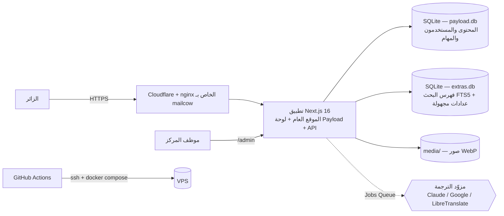

# المعمارية التقنية (Architecture) — الإصدار 2

> تحدّث هذا المستند بعد قرار الانتقال إلى Next.js + Payload (`00-framework-decision.md`). النسخة المخصصة السابقة (Fastify) أُلغيت.

## 1. نظرة عامة



تطبيق واحد في حاوية واحدة. قاعدتا بيانات ملفّيتان: **payload.db** (مصدر الحقيقة) و**extras.db** (مشتقة وقابلة لإعادة البناء: بحث، إحصاءات، حدود المعدل).

## 2. التقنيات

| الطبقة | الاختيار |
|---|---|
| الإطار | Next.js 16 (App Router، Server Components، ISR) |
| إدارة المحتوى | Payload CMS 3.90 (لوحة عربية RTL، صلاحيات، وسائط، تعدد لغات، Jobs Queue) |
| القاعدة | SQLite (libSQL) عبر محوّل Payload + هجرات صريحة |
| البحث | SQLite FTS5 مع تطبيع عربي (حروف، تشكيل، «ال» التعريف) |
| الترجمة | محرك داخلي: مزوّدون قابلون للاستبدال، ذاكرة ترجمة بالتجزئة، قاموس مصطلحات، سقف يومي |
| الصور | `next/image` (WebP/AVIF) + مجموعة وسائط Payload بأحجام متعددة |
| الخطوط | IBM Plex Sans Arabic (واجهة) + Noto Naskh (قراءة) + Source Serif 4 (لاتيني)، مستضافة ذاتياً |
| النشر | Docker متعدد المراحل + GitHub Actions (شحن SSH) خلف nginx/Cloudflare |

## 3. هيكل المستودع

```
src/
  app/(payload)/      لوحة الإدارة وواجهة REST/GraphQL (مولَّدة من Payload)
  app/(site)/[locale]/  الموقع العام: الرئيسية، [section] قوائم، [section]/[id] تفاصيل، search، authors، timeline، contact، saved
  app/api/hc/         translate · suggest · contact · subscribe · health
  app/{sitemap.xml,feeds,legacy,robots.ts,manifest.ts}
  collections/ globals/ hooks/ jobs/ migrations/
  i18n/               languages.ts (≈90 لغة) · translation/{engine,providers,anthropic,blocks,registry} · ui-store · t
  lib/                arabic · dates · sanitize · citations · seo · jsonld · data · ctx · extras · ratelimit
  components/         Shell · Cards · Pagination · StaticPage · client/* (جزر تفاعلية صغيرة)
  styles/             tokens · fonts · base · layout · components · pages
messages/             ar.json (المصدر) · en.json
content/              legacy-snapshot.json.gz
scripts/              import-legacy · seed · build-brand
```

## 4. مجموعات Payload

محتوى: `news · articles · books · magazines · events · forum-events · videos` (حقول مشتركة: العنوان/الملخص/النص محلية، الحالة، التاريخ ودقته، `legacyId`، `translationMeta`)، `authors · categories · pages · timeline`. نظام: `media · glossary · messages · subscribers · translation-usage · users`. عام: `site`.

## 5. تدفق الترجمة

1. محرر ينشر بالعربية ← خطاف `afterChange` يُفهرس للبحث ويُدرج مهمة `translate-doc` للغات المسبقة (`TRANSLATION_EAGER_LANGS`) واللغات المترجم إليها سابقاً.
2. زائر يختار لغة غير جاهزة ← الصفحة تظهر بالعربية + شريط «جارٍ إعداد الترجمة»، والمتصفح (لا الزواحف) يرسل `POST /api/hc/translate` ثم يستعلم حتى الجاهزية ويحدّث الصفحة.
3. المهمة تقرأ الحقول العربية، تقارن التجزئة بـ`translationMeta`، تترجم الناقص فقط (نص عادي دفعة واحدة، HTML كتلاً مع التحقق من سلامة الوسوم)، وتكتب الحقول المحلية دون المساس بما عدّله إنسان.
4. بعد الكتابة: إعادة فهرسة البحث وتجديد ذاكرة الصفحات.

## 6. الأمان والأداء (مختصر)
رؤوس أمان وCSP، حدود معدل على كل نقطة كتابة عامة (مخزنة في extras.db)، honeypot، صلاحيات حسب الدور (مدير/محرر/مراجع ترجمة)، تعقيم HTML صارم، جلسات بكوكي HttpOnly، قفل الحساب بعد 5 محاولات. الأداء: ISR، استبعاد `body` من القوائم، فهارس `_locales`، صور محسّنة، ضغط وتخزين مؤقت في Cloudflare.
