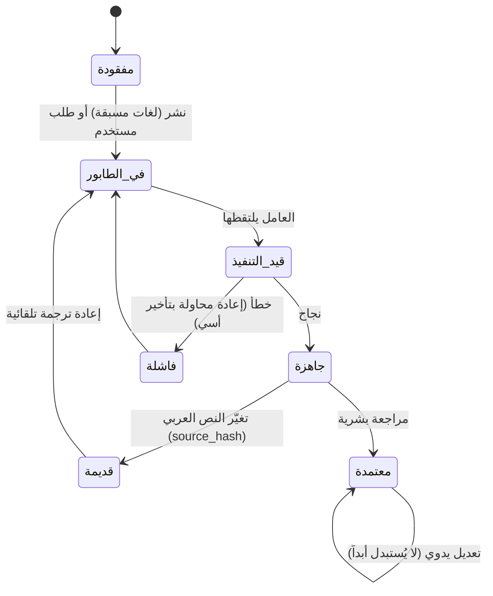

# نظام اللغات والترجمة الآلية (i18n & Auto-Translation)

> **الشرط:** موظف المركز يكتب بالعربية فقط، والموقع يُقرأ بأي لغة، بجودة تليق بمركز أكاديمي.

## 1. طبقتان منفصلتان

| الطبقة | ما تشمله | المصدر | الترجمة |
|---|---|---|---|
| **واجهة الموقع (UI)** | قوائم، أزرار، رسائل، تسميات (~300 نص) | `locales/ar.json` (المصدر) | `en` تُكتب يدوياً؛ لغات أخرى مُسبقة التوليد أو عند الطلب وتُحفظ |
| **المحتوى (Content)** | أخبار، مقالات، كتب، فعاليات… بحقولها | قاعدة البيانات (عربي) | عند النشر للّغات «المسبقة» + عند الطلب لغيرها، وتُحفظ للأبد (ذاكرة ترجمة) |

## 2. روابط اللغات

`/{lang}/…` بمجلد فرعي (موصى به من جوجل). `lang` رمز BCP-47 مختصر (`ar`, `en`, `fr`, `id`, `zh`, `pt-br`…). الجذر `/` يوجّه حسب: كوكي التفضيل ← `Accept-Language` ← `ar`.

## 3. كتالوج اللغات

ملف `src/i18n/languages.ts`: ~90 لغة بكل من: الرمز، الاسم بكتابته الأصلية (Endonym)، الاسم بالعربية والإنجليزية، الاتجاه (`rtl` لـ: ar, fa, ur, he, ps, sd, ug, yi, dv, ckb)، مستوى الدعم (`curated` / `priority` / `on-demand`). **لا أعلام** (اللغة ليست دولة). البحث داخل منتقي اللغة يعمل بالأسماء الثلاثة.

## 4. دورة حياة ترجمة المحتوى



- **`source_hash`**: بصمة النص العربي وقت الترجمة. إذا تغيّر النص صارت الترجمة «قديمة» وتُعاد جدولتها، **إلا** إن كانت `manual` (يدوية) فتبقى كما هي ويُنبَّه المحرر.
- **التقسيم:** النص الطويل يُقسَّم إلى كتل HTML (فقرات/عناوين/قوائم) ≤ ~1500 حرف ويُترجم على دفعات مع **حفظ الوسوم والروابط كما هي**.
- **الذاكرة:** كتل متطابقة (بنفس البصمة واللغة) تُعاد من الذاكرة بلا استدعاء جديد.

## 5. متى تُطلَق الترجمة؟

| الحالة | السلوك |
|---|---|
| نشر محتوى جديد | يُجدول للّغات في `TRANSLATION_EAGER_LANGS` (افتراضي: `en`) |
| زائر يختار لغة بلا ترجمة | الصفحة تظهر بالعربية + شريط «جارٍ إعداد الترجمة»؛ **سكربت الصفحة** يطلب الترجمة (`POST /api/translation/request`) ثم يستعلم ويُحدّث الصفحة عند الجاهزية |
| زاحف/بوت | **لا يطلق ترجمة أبداً** (الطلب من JS بعد تفاعل المستخدم + حدود معدل + سقف يومي) |
| المحرر في الإدارة | أزرار: «ترجم الآن» / «إعادة ترجمة» / «ترجم كل المحتوى إلى لغة» |

## 6. مزوّدو الترجمة

واجهة موحّدة:

```ts
interface TranslationProvider {
  readonly name: string;
  translate(req: {
    texts: string[];              // وحدات نصية أو HTML
    format: 'text' | 'html';
    from: 'ar'; to: string;
    glossary: GlossaryEntry[];    // مصطلحات ملزِمة لهذه اللغة
    context?: string;             // نوع المحتوى (دراسة تاريخية، خبر…)
  }): Promise<{ texts: string[]; usage?: { inChars: number; outChars: number } }>;
}
```

| المزوّد | `TRANSLATION_PROVIDER` | المتغيرات | ملاحظة |
|---|---|---|---|
| Claude | `anthropic` | `ANTHROPIC_API_KEY`, `TRANSLATION_MODEL` | **الموصى به**: يلتزم بالقاموس والسياق، يحافظ على الوسوم |
| Google Cloud | `google` | `GOOGLE_TRANSLATE_API_KEY` | تغطية واسعة، `format=html` أصلي |
| LibreTranslate | `libretranslate` | `LIBRETRANSLATE_URL`, `LIBRETRANSLATE_API_KEY` | ذاتي الاستضافة |
| وهمي | `mock` | — | للاختبار والتطوير (يلصق رمز اللغة) |
| بلا مزوّد | `none` | — | العربية + الإنجليزية اليدوية فقط |

### 6.1 قرار 2026-10-15: المزوّد المجاني المعتمد
المعتمد افتراضياً للإنتاج: **Cloudflare Workers AI** (، النموذج `@cf/mistralai/mistral-small-3.1-24b-instruct`) — حد مجاني 10,000 neuron/يوم بلا بطاقة، يعمل ببروتوكول الشرائح نفسه فيحافظ على الوسوم والمصطلحات. تفاصيل الاختيار في `docs/08-review/01-site-review-old-vs-new.md` والدليل التشغيلي في `docs/06-handover/translation-guide-ar.md`.

### 6.1 قرار 2026-10-15: المزوّد المجاني المعتمد
المعتمد افتراضياً للإنتاج: **Cloudflare Workers AI** (`TRANSLATION_PROVIDER=cloudflare`، النموذج `@cf/mistralai/mistral-small-3.1-24b-instruct`) — حد مجاني 10,000 neuron/يوم بلا بطاقة دفع، ويعمل ببروتوكول الشرائح نفسه فيحافظ على الوسوم والمصطلحات. تفاصيل المقارنة في `docs/08-review/01-site-review-old-vs-new.md`، والدليل التشغيلي في `docs/06-handover/translation-guide-ar.md`.

## 7. قاموس المصطلحات (Glossary)

جدول يحدده المركز تدريجياً: `سمهرم → Sumhuram`، `حضرموت → Hadhramaut`، `القعيطي → Qu'aiti`، `الكثيري → Kathiri`، `شبام → Shibam`… يُرسَل للمزوّد كتعليمات ملزِمة، وتُطبَّق تصحيحات حتمية بعد الترجمة للمصطلحات المسجلة (ضمان الاتساق). يحتوي أيضاً على «**لا تترجم**»: الاقتباسات القرآنية، العناوين المحققة، أسماء المراجع.

أوامر النظام للمزوّد (ملخص): «ترجم من العربية إلى {لغة} نصاً تاريخياً أكاديمياً. حافظ على كل الوسوم والسمات. لا تضف ولا تحذف معنى. أبقِ الآيات والأحاديث بصيغتها العربية مع ترجمة المعنى بين قوسين عند الحاجة. استخدم القاموس حرفياً. أسماء الأعلام: نقحرة معيارية.»

## 8. التحكم في الكلفة والجودة

- **سقف يومي** (`TRANSLATION_DAILY_CHAR_LIMIT`) وتقدير الكلفة في لوحة الإدارة.
- **قائمة اللغات المسموحة** (`TRANSLATION_ENABLED_LANGS`) — افتراضياً كل الكتالوج.
- **أولوية الطابور:** الصفحات الأكثر زيارة وعناوين/ملخصات أولاً، ثم الأجسام الطويلة.
- **مراجعة بشرية:** حالة «معتمدة» + وسم «مراجعة بشرية» ظاهر للقارئ.
- **بلاغ جودة:** رابط «اقترح تصحيحاً للترجمة» في كل صفحة مترجمة.

## 9. السيو للصفحات المترجمة

- الصفحة المترجمة **كاملة** ← `index` + `hreflang` متبادل + canonical ذاتي.
- الصفحة **الجزئية أو الاحتياطية** (مختلطة) ← `noindex, nofollow` + canonical للعربية.
- لا تُدرَج في `hreflang` ولا في خريطة الموقع إلا اللغات **الجاهزة** لتلك الصفحة.
- روابط اللغات غير الجاهزة تحمل `rel="nofollow"`.

## 10. الوصولية والاتجاه

- `<html lang dir>` من لغة الصفحة؛ ومقاطع بلغة مختلفة تحمل `lang`/`dir` خاصتها.
- الواجهة بلغة الهدف، مع **تسلسل احتياطي**: لغة الهدف ← الإنجليزية ← العربية.
- الأرقام: لاتينية (0-9) في كل اللغات للاتساق مع الاستشهادات؛ التواريخ بـ`Intl` بحسب اللغة، ويُضاف التاريخ الهجري عند العربية.
