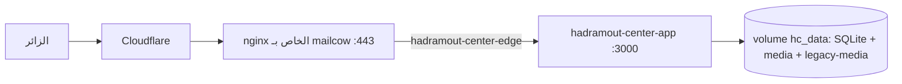

# دليل النشر على الخادم (VPS)

الهدف: تشغيل المنصة على `https://hadramout-center.novixa.dev` بنشر آلي عبر GitHub Actions.

## 0. بنية الخادم الفعلية (مهم)
الخادم مشترك (يحتوي mailcow وغيره). **منفذا 80/443 يملكهما nginx الخاص بـmailcow خلف Cloudflare**، لذلك:
- لا نستخدم Caddy ولا ننشر أي منفذ للتطبيق.
- حاوية التطبيق `hadramout-center-app` (منفذ داخلي 3000) على شبكة Docker خارجية `hadramout-center-edge`، وnginx يمرّر إليها (`deploy/nginx/hadramout-center.conf`).
- شهادة TLS هي Cloudflare Origin Certificate لـ`*.novixa.dev` (يتولاها `server-setup.sh`).
- ترويسات الأمان (CSP/HSTS…) يضعها التطبيق نفسه؛ nginx لا يكررها.



## 1. تجهيز الخادم (مرة واحدة)
على الخادم كمستخدم root، من نسخة من مجلد `deploy/`:
```bash
bash deploy/server-setup.sh
```
ينشئ `/opt/hadramout-center` والشبكة، يصل nginx بها، يثبّت شهادة الأصل وكتلة الموقع بعد اختبار `nginx -t` (ويتراجع إن فشل).
ثم أنشئ `/opt/hadramout-center/.env` من `deploy/.env.production.example`:
- `PAYLOAD_SECRET`: `openssl rand -hex 32` (لا يتغير بعد الإطلاق).
- `ADMIN_EMAIL` / `ADMIN_PASSWORD`: أول مدير.
- `TRANSLATION_PROVIDER=anthropic` و`ANTHROPIC_API_KEY` لتفعيل الترجمة، أو اتركه `none`.

## 2. أسرار GitHub
Settings ← Secrets and variables ← Actions: `DEPLOY_HOST` و`DEPLOY_USER` و`DEPLOY_SSH_KEY` (نفسها المستخدمة سابقاً)، وبصمة مفتاح الخادم مثبّتة في `deploy.yml` (`HOST_KEY_FINGERPRINT`). Environment باسم `production`.

## 3. آلية النشر
عند الدفع إلى `master` (أو تشغيل يدوي): فحص (typecheck + lint + tests) ← بناء صورة Docker في CI ← شحنها إلى الخادم عبر SSH (`docker save | docker load`، دون سجل صور) ← رفع `docker-compose.yml` والسكربتات ← `deploy.sh` (نسخة احتياطية، تشغيل، انتظار الصحة، **تراجع تلقائي** عند الفشل) ← فحص عام عبر `/api/hc/health`.

## 4. أول نشر
1. شغّل Deploy يدوياً مع **`with_tools = true`** (يشحن أيضاً صورة الأدوات للاستيراد).
2. **فوراً** بعد نجاحه (لأن إنشاء أول مستخدم مفتوح حتى يوجد مستخدم) على الخادم:
```bash
cd /opt/hadramout-center
docker compose run --rm tools npm run db:seed          # استيراد 1,454 عنصراً + إنشاء المدير
docker compose run --rm tools npm run import:images    # نسخ ≈4,500 صورة (تُنزَّل أيضاً عند أول طلب)
```
3. افتح `https://hadramout-center.novixa.dev/admin`.

> الهجرات تُطبَّق تلقائياً عند إقلاع التطبيق.

## 5. التراجع اليدوي
Actions ← Deploy ← Run workflow وأدخل `tag` لصورة سابقة محمّلة على الخادم (مثل `sha-1a2b3c4`؛ يحتفظ الخادم بآخر 3). أو على الخادم: عدّل `APP_IMAGE` في `.env` ثم `docker compose up -d app`.

## 6. النسخ الاحتياطي
```bash
crontab -e   # root أو مستخدم docker
15 3 * * * /opt/hadramout-center/scripts/backup.sh daily >> /opt/hadramout-center/backups/cron.log 2>&1
```
- يحتفظ بآخر 14 نسخة. انسخ `backups/` دورياً خارج الخادم (rclone/rsync).
- الاستعادة: `./scripts/restore.sh backups/<الملف>.tgz` — **اختبرها مرة قبل الإطلاق.**
- نسخ الصور المنقولة (`legacy-media`) جزء من النسخة الاحتياطية.

## 7. التشغيل اليومي
```bash
docker compose ps
docker compose logs -f app
docker compose restart app
curl -s https://hadramout-center.novixa.dev/api/hc/health
```
أضف رابط الصحة إلى UptimeRobot أو Better Stack.

## 8. نقاط للانتباه
- SQLite على قرص واحد ⇒ **نسخة واحدة من التطبيق فقط** (يكفي لمئات آلاف الزيارات شهرياً مع Cloudflare؛ للتوسع لاحقاً يلزم Postgres).
- إعدادات التخزين المؤقت في Cloudflare: لا تخزّن `/admin` و`/api/*`.
- تكلفة الترجمة تُضبط بـ`TRANSLATION_DAILY_CHAR_LIMIT` و`TRANSLATION_MODEL`.
- **لم يُختبر Docker ولا السكربتات على الخادم الفعلي** — راقب أول نشر وراجع السجلات.
