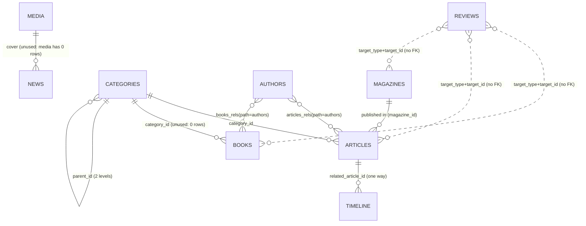

# Data Model and Taxonomy (verified, as built)

| | |
|---|---|
| **Purpose** | Document every content type and supporting collection as it exists in code and in the data, measure the real data quality (fill rates, relationships, dates, authors, categories), evaluate the taxonomy against what the Center publishes, and list concrete, testable fixes. |
| **Scope** | `src/collections/*`, `src/payload.config.ts`, `src/migrations/*`, `src/lib/{facets,facet-core,list-query,content-types,dates,citations,arabic}.ts`, `src/importer/*`, `src/seed/seed.ts`, a read-only **copy** of `data/payload.db` (25,092,096 bytes, modified 2026-10-16), the legacy snapshot `content/legacy-snapshot.json.gz`, and GET-only probes of production and the legacy site. Out of scope: visual design, translation quality, security (other audit areas). |
| **Status** | Draft for review. All tasks in section 12 are `BACKLOG`. No file in the repository other than this document and [`INFORMATION_ARCHITECTURE.md`](./INFORMATION_ARCHITECTURE.md) was written. |
| **Last updated** | 2026-10-18 |
| **Finding prefix** | `DATA-` (section 11) |
| **Supersedes / corrects** | Extends [`../02-plan/06-content-model-and-migration.md`](../02-plan/06-content-model-and-migration.md) (Arabic, describes a `posts` table that no longer exists) and corrects item C1 of [`../09-redesign/02-editorial-issues.md`](../09-redesign/02-editorial-issues.md) (see DATA-005 and section 13). |
| **Sources / evidence** | Source at `master` HEAD `d8ed733`. Database copy and scratch scripts live in the session scratchpad (not in the repo). Production probes on 2026-10-18 (about 45 GET requests, 300 ms or more apart). Legacy probes: 4 GET requests. No secret was read or printed. |

Related: [System architecture](./SYSTEM_ARCHITECTURE.md) · [Information architecture](./INFORMATION_ARCHITECTURE.md) · [Legacy site inventory](../audit/LEGACY_SITE_INVENTORY.md) · [Editorial issues](../09-redesign/02-editorial-issues.md) · [Docs index](../00-INDEX.md)

**Tag legend.** **[src]** read from the repository at HEAD. **[db]** measured on the copied `payload.db`. **[prod]** observed on `https://hadramout-center.novixa.dev`. **[legacy]** observed on `https://hadramout.center`. **[sim]** produced by replaying repository migration code on a throw-away copy of the database.

---

## 1. Executive summary

* The schema is sound and the data is **referentially clean**: `PRAGMA integrity_check` = ok, `PRAGMA foreign_key_check` = 0 rows, 0 dangling relationships, 0 duplicate `legacy_id`, 0 future dates, 0 year-0 dates, 0 U+FFFD in any title [db]. 1,454 items across 7 content types.
* **Local DB equals production** for content: item counts per type match the production sitemap exactly (909 / 387 / 52 / 40 / 53 / 11 / 2) and 10 of 10 sampled ids return identical titles locally and on production [prod, db] (section 2). The database copy is, however, **older than HEAD**: it has only migrations 1 and 2 applied, so it has neither the topic hierarchy, the reviews table nor the editorial fixes (section 9). Production is also on the pre-redesign release (`/ar/topics` returns 404).
* The most serious data problem is **dates** (DATA-001): 713 of 909 articles (78%) and 28 of 40 magazine issues carry a "publication date" of 2023 that is really the month the cover image was uploaded to the legacy site. It is shown to readers as "October 2023", used in citations as "(2023)", exposed as `datePublished` in JSON-LD and drives the year facet. The legacy site shows no such date.
* The taxonomy is the magazine's **column list**, not a subject classification (DATA-003): 53 flat "categories" on articles only; none on books (0/52), news (0/387), events or videos. The redesign groups columns into 8 topics, which is a sound navigation aid, but history/heritage/archaeology (the Center's core subject) is only 42 of 909 articles (4.6%) under the migration's grouping, and nothing lets a reader browse by place, period or theme although the texts mention places heavily (for example "المكلا" in 350 of 909 article bodies).
* Author data needs a clean-up (DATA-005, DATA-006): two honorific fragments are stored as authors because of a splitting bug (`الشيخ`, `أ.م.د`), 19 probable duplicate pairs, a role stored inside a name (`... - رئيس التحرير`, 24 articles), 6 non-person "authors", and 0 of 274 author bios.
* 714 of 909 article excerpts (78.5%) start with the boilerplate "المرجع : مجلة حضرموت الثقافية .. العدد N .. ص P رابط العدد N : اضغط هنا" (DATA-002). It is the first thing in the production `<meta name="description">` and `og:description` of those pages.
* Indexes cover every real query pattern at the current size (section 6). The remaining gaps are minor (DATA-014).

---

## 2. Which data is this? Local DB versus production

| Check | Result | Evidence |
|---|---|---|
| Items per type, local vs production sitemap (list page excluded) | Identical: articles 909, news 387, events 53, books 52, magazines 40, forum 11, videos 2 (total 1,454) | `payload.db` row counts; production `GET /sitemap.xml` (200, 542,506 bytes, 1,487 `<url>`) grouped by path [db, prod] |
| Id/title parity, 10 sampled detail pages | 10 of 10 equal (articles 1, 690, 909; news 300, 387; books 52; magazines 40; events 30; forum 11; videos 2) | `GET /ar/{section}/{id}` `<title>` vs `*_locales.title` [db, prod] |
| Year facet parity | `GET /ar/articles?year=2023` returns "713 نتيجة"; the DB has 713 articles dated 2023 | [prod, db] |
| Migrations applied | Local copy: 2 of 6 (`initial`, `locales_indexes`). Production schema level **NOT VERIFIED** (database not readable); behaviour (no `/ar/topics`, no reviews UI) is consistent with the same 2 migrations | `payload_migrations` rows [db]; `GET /ar/topics` = 404, `/ar/topics/54` = 404 [prod] |
| Translations | Local copy holds only the `ar` locale (`articles_locales`: 909 rows, `_locale='ar'`). Production serves at least some `en` content (`/en/news/300` is in its sitemap). Translation completeness on production is **NOT VERIFIED** here (other audit area). | [db, prod] |
| Editorial edits made on production after the snapshot | **NOT VERIFIED**. No way to read production rows. Counts and ten samples match, which bounds but does not exclude edits. | n/a |

Conclusion: all content statistics below describe the legacy migration as it is live today. Statistics about topics are given as **[sim]** because that is the state production will reach when HEAD is deployed.

---

## 3. Entity overview

Seven content collections share one base field set (`baseFields`, `src/collections/shared.ts:64-170`): `news`, `articles`, `books`, `magazines`, `events`, `forum-events` (public route `forum`), `videos`. The registry `src/lib/content-types.ts` maps type, Payload slug, public route and legacy section so that routes, importer, sitemap and search cannot disagree. Supporting collections: `authors`, `categories`, `pages`, `timeline`, `media`, `glossary`, `reviews`, `messages`, `subscribers`, `translation-usage`, `users`; one global `site`.

**Storage model [src, db].** Payload's SQLite adapter stores each collection in a parent table (non-localized columns) plus `<name>_locales` (one row per document per locale: `title`, `excerpt`, `body`, `cover_alt` and per-type text fields) plus `<name>_rels` for relationship arrays. Translations are therefore additional rows in `*_locales` in the same database file (section 10, DATA-022). Bodies are sanitized HTML in a `textarea`, not rich-text JSON (`shared.ts:66, 86`, `sanitizeBody` in `beforeValidate`).

---

## 4. Content collections: fields, constraints, fill rates

### 4.1 Shared base fields (all seven content types) [src: `shared.ts:64-170`]

| Field | Type | Localized | Constraint / index | Notes |
|---|---|---|---|---|
| `title` | text | yes | required | |
| `excerpt` | textarea | yes | none | "generated from text when empty" |
| `body` | textarea (HTML) | yes | `beforeValidate: cleanBody` (sanitizer allow-list) | max text length 3,000,000 (`payload.config.ts`) |
| `cover` | upload to `media` | no | FK `cover_id`, index | **0 of 1,454 rows use it** (media table is empty) |
| `coverUrl` | text | no | read-only | all covers are legacy URLs (`files.hadramout.center`) |
| `coverAlt` | text | yes | | |
| `status` | select draft / published / archived | no | required, default `draft`, **index** | all rows `published` |
| `featured` | checkbox | no | default false | **no reader-facing code uses it** (DATA-011); 0 rows true |
| `publishedAt` | date | no | **index** | meaning differs per type (section 8) |
| `datePrecision` | select day / month / year / estimated / none | no | default `day` | `estimated` and `none` are hidden from readers (`src/lib/ctx.ts:54-58`) |
| `legacyId` | number | no | **unique index** | redirect key for old URLs (`src/app/legacy/[section]/[id]/route.ts`) |
| `legacyUrl`, `source`, `edited`, `translationMeta` | text / select / checkbox / json | no | | `edited` protects human edits from re-import |

Cover and date are omitted for `articles` (`cover: false`), so articles have no image field at all.

### 4.2 Per-type fields and relations [src: `src/collections/content.ts`]

| Type (collection) | Extra fields | Relations | Constraints / indexes |
|---|---|---|---|
| **News** (`news`) | `dateline` (localized) | none | defaultSort `-publishedAt` |
| **Articles** (`articles`) | none of its own | `authors` (hasMany), `category` (one), `magazine` (one) | indexes: `category_id`, `magazine_id`, `authors_id` (rels) |
| **Books** (`books`) | `publisher`, `edition`, `editor`, `translator` (localized); `year` (1800-2100), `pages` (min 1), `isbn`, `pdf` | `authors` (hasMany), `category` | index `category_id`, `authors_id` |
| **Magazines** (`magazines`) | `issueNumber` (required, **unique**, index), `season` (localized), `pdf` | none (articles point to it) | unique `issue_number` |
| **Events** (`events`) and **Forum events** (`forum-events`) | `speaker`, `moderator`, `venue`, `timeText` (localized); `eventDate`, `endDate`; `youtubeId`, `link` | none | no index on `event_date` (filtering is in memory) |
| **Videos** (`videos`) | `youtubeId`, `embedUrl`, `duration`, `guest` (localized) | none | |

Access: public read of `published` only, create for admin/editor, update for any staff, delete for admin (`shared.ts:31-36`). Reviewers can write localized fields only outside `ar`.

### 4.3 Supporting collections

| Collection | Fields | Constraints / indexes | Rows [db] |
|---|---|---|---:|
| `authors` | `name` (localized, required), `nameKey` (text), `bio` (localized), `translationMeta` | **unique** `name_key`; `authors_locales_parent_idx` | 274 (bio: 0) |
| `categories` | `name` (localized), `kind` (article / book), `parent` (self, 2 levels, `filterOptions`), `order` (default 100), `description` (localized) | `parent_id` index (migration 3); no index on `kind` | 53 local; **58 after migrations 3-4** [sim] |
| `pages` | `title`, `body` (localized), `slug`, `status` | **unique** `slug` | 4 (about, privacy, terms, accessibility) |
| `timeline` | `title`, `body`, `era` (localized); `yearFrom` (required, negative = BCE), `yearTo`; `source`, `sourceUrl`; `relatedArticle` (to articles); `reviewStatus`, `reviewedAt`; `status` | index `related_article_id` (migration 3) | 6 |
| `media` | upload (`image/*`, PDF; sizes thumb 320, card 720, large 1400 WebP); `alt` (localized); `sourceUrl` | index `source_url`, unique `filename` | **0** |
| `glossary` | `termAr`, `lang` (`*` or language code), `translation`, `kind` (term / person / place / org / keep) | index `term_ar` | 28 (19 place, 4 org, 5 term) |
| `reviews` (migration 3) | `targetType` (book / article / magazine), `targetId` (number), `rating` 1-5, `name`, `body` (max 2,000), `lang`, `status` (pending / approved / rejected), `fingerprint` | indexes on `target_type`, `target_id`, `status`, `fingerprint` | not in local copy |
| `messages`, `subscribers`, `translation-usage`, `users` | contact form, newsletter (unique `email`), translation budget (unique `key`), staff (role admin / editor / reviewer) | | 0, 0, 0, 1 |
| global `site` | tagline, description, address, email, WhatsApp array, social links, `reviewsEnabled` | | 1 |

### 4.4 Field fill rates on the real data [db, Arabic locale, n = rows of that type]

| Field | news (387) | articles (909) | books (52) | magazines (40) | events (53) | forum (11) | videos (2) |
|---|---:|---:|---:|---:|---:|---:|---:|
| title empty | 0 | 0 | 0 | 0 | 0 | 0 | 0 |
| excerpt empty | 0 | 0 | 0 | 0 | 2 | 0 | 0 |
| body empty | 0 | 0 | 0 | 0 | 2 | 0 | 0 |
| body under 200 chars (text) | 6 | 0 | 2 | 0 | 27 | 1 | 1 |
| cover (`cover_id`) set | 0 | n/a | 0 | 0 | 0 | 0 | 0 |
| cover (`cover_url`) set | 387 | n/a | 52 | 40 | **0** | **0** | 1 |
| `publishedAt` set | 387 | 909 | 52 | 40 | 53 | 11 | 2 |
| category set | n/a | 767 (84.4%) | **0** | n/a | n/a | n/a | n/a |
| authors set | n/a | 909 | 45 | n/a | n/a | n/a | n/a |
| magazine set | n/a | 894 (98.3%) | n/a | n/a | n/a | n/a | n/a |
| `year` set | n/a | n/a | 48 | n/a | n/a | n/a | n/a |
| `pdf` set | n/a | n/a | 21 | 40 | n/a | n/a | n/a |
| `pages`, `isbn` set | n/a | n/a | **0, 0** | n/a | n/a | n/a | n/a |
| `publisher` / `edition` / `editor` / `translator` set | n/a | n/a | 48 / 17 / 11 / 6 | n/a | n/a | n/a | n/a |
| `dateline` set | 29 | n/a | n/a | n/a | n/a | n/a | n/a |
| `season` set | n/a | n/a | n/a | **0** | n/a | n/a | n/a |
| `eventDate` set | n/a | n/a | n/a | n/a | 53 | 5 | n/a |
| `endDate` set | n/a | n/a | n/a | n/a | 12 | 0 | n/a |
| `speaker` / `moderator` / `venue` / `timeText` set | n/a | n/a | n/a | n/a | 5 / 2 / 2 / 1 | 6 / 6 / 5 / 5 | n/a |
| `youtubeId` set | n/a | n/a | n/a | n/a | 0 | 11 | 1 |
| `link` (join link) set | n/a | n/a | n/a | n/a | 0 | 0 | n/a |
| `datePrecision` | all `day` | 894 month, 15 estimated | 48 year, 4 estimated | 40 month | all `day` | 5 day, 6 estimated | 2 estimated |
| `featured` true | 0 | 0 | 0 | 0 | 0 | 0 | 0 |

Observations: books have no ISBN or page count at all (citations omit them, DATA-016); events carry almost no structured data and no image (DATA-007); 7 of 52 books have no author, and 6 of the 45 that do have an event name as "author", for example «المؤتمر العلمي الرابع» (DATA-006); magazine `season` is entirely unused.

### 4.5 Text and encoding quality [db]

| Check | Result |
|---|---|
| U+FFFD in any title | 0 in all 7 types. One U+FFFD exists inside an `` file name in news 331 (a legacy file name), harmless to text. |
| Bidi control characters (U+200E/F, U+2066-2069) in titles | 4 books (ids 1-4) and 1 article; already tracked as LEG-013 in [`../audit/LEGACY_SITE_INVENTORY.md`](../audit/LEGACY_SITE_INVENTORY.md). |
| Markdown asterisks in titles | 10 articles, 4 forum events (fixed by migration 5 once deployed, see DATA-013); live on production today (`/ar/articles/97` `<title>` ends with `**`). |
| Titles longer than 160 characters | 4 news items (ids 31, 257, 269, 303; max 214). Page titles are clipped to 54 characters by `titlePart` (`src/lib/seo-text.ts`). |
| Titles shorter than 8 characters | 23 articles (poems and column pieces such as "شبام", "غزة"); legitimate. |
| Duplicate titles | articles: 4 groups / 16 rows, all serial columns (for example "نوافذ حضرمية على شجن في الطريق .. نصوص قصيرة جدًّا" x7, "انهمارات حضرمية" x5, "سقطرى" x2); news: 1 pair (ids 348 and 349, different dates). There is no slug, so duplicate titles cannot collide (DATA-008), but there is no series model either (DATA-021). |
| Zero-width / BOM / soft-hyphen characters in bodies | 9 bodies of news and articles; not a defect for display. |
| Scripts / event handlers in bodies | 0. |

---

## 5. Relationships and referential integrity [db]

| Check | Result |
|---|---|
| `PRAGMA integrity_check` | `ok` |
| `PRAGMA foreign_key_check` | 0 rows |
| `articles_rels` rows pointing to a missing author | 0 |
| Articles whose `magazine_id` points to a missing magazine | 0 |
| Articles / authors with no Arabic locale row | 0 / 0 |
| Articles with no author relation | 0 (909 have at least one; 912 relation rows, so only 3 articles have 2 authors) |
| Books with no author relation | 7 (ids 21, 23-27, 31) |
| Authors with no article or book | 0 (every author is linked) |
| Authors by number of works | 1 work: 124; 2: 51; 3: 33; 4-5: 21; 6+: 45; maximum 51 |
| Duplicate `legacy_id` within a type | 0 (all 1,454 unique) |
| Dates after 2026-10-18, before 1900, or year 0 | 0 |
| `end_date` earlier than `event_date` | 6 events (see below) |

The 6 events with `end_date < event_date` are a data defect of small impact (the end date is hidden unless set); recorded for the editors, no code fix needed. `reviews.targetId` is a plain number plus a type string, so deleting a book leaves its reviews pointing nowhere (the database cannot enforce it; DATA-014).

Articles per magazine issue: issues 1-37 have 15 to 54 articles each; **issues 38, 39, 40 and 41 have 0 articles** and 15 articles have no issue. The legacy article ids end at 9597 while issue 38's legacy id is 9610, so the missing contents are a source limitation, not an import loss (see [`../audit/LEGACY_SITE_INVENTORY.md`](../audit/LEGACY_SITE_INVENTORY.md) section 2 for the id ranges). Those four issue pages therefore have no table of contents (DATA-012).

---

## 6. Indexes versus real query patterns

Query patterns come from `src/lib/facets.ts`, `src/lib/data.ts`, `src/app/legacy/[section]/[id]/route.ts`, `src/lib/reviews.ts`. The facet engine loads one compact row per published document per type (`getRows`, `limit: 5000`, cached 5 minutes) and filters, sorts and counts in memory, so the database sees few distinct queries. `EXPLAIN QUERY PLAN` was run on the **post-migration copy** [sim] (all six migrations replayed):

| Pattern (caller) | Plan | Verdict |
|---|---|---|
| Published rows of a type (`getRows`) | `SEARCH articles USING INDEX articles_status_idx (status=?)` + temp b-tree for ORDER BY | ok (909 rows) |
| Locale join for `title`, etc. | `SEARCH l USING INDEX articles_locales_locale_parent_id_unique (_locale=? AND _parent_id=?)` | ok |
| Locale rows by parent only | `articles_locales_parent_idx (_parent_id=?)` | ok (added by migration 2; without it a correlated sub-select scanned the table, "about 30 s for 900 articles" per the migration comment) |
| Authors of an article, articles by author | `articles_rels_parent_idx`, `articles_rels_authors_id_idx` | ok |
| Articles by magazine / category | `articles_magazine_idx`, `articles_category_idx` (covering) | ok |
| Legacy URL redirect (`legacy_id = ?`) | `articles_legacy_id_idx` (unique, covering) | ok |
| Page by slug | `pages_slug_idx` (unique) | ok |
| Category children | `categories_parent_idx` | ok |
| Categories where `kind = 'article'` | `SCAN categories` | acceptable: 58 rows |
| Reviews approved for one target | planner picks `reviews_status_idx (status=?)` only | add composite `(target_type, target_id, status)` before reviews grow (DATA-014) |
| Timeline ordered by `year_from` | `SCAN timeline` + temp b-tree | acceptable: 6 rows |
| Events upcoming (`event_date >=`, as built by `listDocs`) | `events_status_idx` + sort | acceptable: 53 rows. `listDocs` in `src/lib/data.ts` has no caller outside its own file (dead code); the live path filters in memory |
| Books by `year` | `SCAN books` | acceptable: 52 rows; the year filter runs in memory |

Missing-but-needed-at-scale list: (1) reviews composite index; (2) none of the in-memory caps (`getRows` 5,000 rows, `listAuthors` 5,000, categories 500) log a warning when exceeded. Today's largest set is 909 (18% of the cap). There is no index gap that affects today's pages.

---

## 7. Taxonomy analysis

### 7.1 What the "categories" actually are

All 53 imported categories belong to articles and are the **columns of the printed journal** (أبواب المجلة): أضواء (107 articles), إبداع (85), كتابات (73), دراسات (72), نقد (50), شخصيات (46) and so on [db]. They are flat, contain spelling variants (`حديث الباية`, `درايسات`, `أضو`), credit lines used as categories (`تحقيق وتصوير: عبدالله عوض بكير - صالح الفردي`, `استطلاع عادل أحمد القحـوم` with a tatweel) and an issue number (`40`). The legacy site had categories **only on articles** (767 of 909 articles carry one in the snapshot; books, news, events, forum, videos and magazines carry none) [legacy snapshot, db], so there is no parity loss on books and news, but also no classification at all outside articles.

### 7.2 Redesign grouping (migrations 3 and 4) [sim]

Replaying migration 3 and migration 4's logic on a copy of the database (no error, `PRAGMA foreign_key_check` = 0):

| Topic (new root, id) | Order | Columns filed | Articles | Share of 909 |
|---|---:|---:|---:|---:|
| الأدب والإبداع (57) | 40 | 9 | 240 | 26.4% |
| مقالات ورؤى (61) | 80 | 9 | 197 | 21.7% |
| دراسات وبحوث (54) | 10 | 3 | 119 | 13.1% |
| قراءات ونقد (60) | 70 | 7 | 65 | 7.2% |
| الأعلام والشخصيات (56) | 30 | 3 | 63 | 6.9% |
| التاريخ والتراث والآثار (55) | 20 | 8 | 42 | 4.6% |
| حوارات ولقاءات واستطلاعات (59) | 60 | 6 | 33 | 3.6% |
| الفنون والمسرح (58) | 50 | 3 | 6 | 0.7% |
| Left as roots without a topic: `40` (36), `توقيع فلم` (43) | 100 | 0 | 2 | 0.2% |
| **No category** | | | **142** | **15.6%** |
| **Total** | | | 909 | |

The result matches the figures in [`../09-redesign/02-editorial-issues.md`](../09-redesign/02-editorial-issues.md) section B (767 categorised, 142 not, 2 in leftover columns), which is now independently confirmed. Topic ids are assigned at migration time (54-61 on this copy), so they are environment-specific (DATA-008). After the migration there are **58 category rows = 58 public topic URLs** (8 topics, 48 columns, 2 loose roots); 18 of the 48 columns hold 2 articles or fewer (12 hold exactly 1), which makes thin landing pages (DATA-004).

### 7.3 Where the 142 uncategorised articles are

Not random: they concentrate in issues 18-28 (8, 8, 13, 18, 18, 7, 13, 9, 16, 9 uncategorised out of 16 to 27 articles per issue; together 119 of the 142), plus 2 in the 15 articles with no issue. Issues 6-9, 11, 13, 16, 32, 33, 35, 36 have 0 uncategorised [db]. This points to a template change in the legacy site around issue 18 rather than editorial choice.

### 7.4 Fit with the Center's content

What the Center publishes (verified from the data): 909 articles from a cultural/historical journal (issues 1-37), 387 news items (2015-12 to 2026-10), 52 books and proceedings with 21 downloadable PDFs, 53 events (2016-2024), 11 forum events (2024), 40 journal issues, 2 videos. The texts are strongly place-based. Simple substring counts over the 909 article bodies (indicative only, includes prefixed forms such as "بالمكلا") [db]:

| Place | In title | In body |
|---|---:|---:|
| المكلا | 20 | 350 |
| تريم | 11 | 237 |
| الشحر | 11 | 195 |
| دوعن | 20 | 172 |
| سيئون | 3 | 170 |
| شبام | 13 | 162 |
| وادي حضرموت | 5 | 154 |
| شبوة | 2 | 62 |
| سقطرى | 3 | 36 |
| عدن | 12 | 375 |

Other recurring themes in titles: poetry (79 titles contain شعر / قصيدة / الشاعر), maritime history and ports (16), language and dialect (13), archaeology (9), architecture (7), sultanates (7), manuscripts (3). The current taxonomy exposes none of these: a reader interested in "Tarim" or "ports and navigation" must use free-text search. The glossary already lists 19 curated place names with English renderings, which is a seed for a place vocabulary. The recommendation (DATA-003, task T3) is a small, editor-owned **subjects** vocabulary (place, period, theme) attached to all content types, not a replacement of the column topics.

What is not modelled: the Center's name includes "التوثيق" (documentation), but there is no collection for photographs, manuscripts, documents, maps or oral history. Whether the Center holds such collections and wants them online is **NOT VERIFIED** (no source in the repository or on the legacy site says so); see DATA-021.

### 7.5 Authors

* 274 authors; 88 (32%) store an honorific prefix (`أ.د.`, `د.`, `أ.`, `الشيخ`...) inside `name`. `nameKey` strips titles for merging (`src/lib/arabic.ts`, `authorKey`), so the same person with and without a title merges, but the displayed `name` is whichever spelling was most common at seed time.
* **Splitting bug (DATA-005).** `splitAuthors` splits on `/` (`src/lib/arabic.ts:115-120`). Three legacy bylines use `/` after a title: `الشيخ/ أمين سعيد عوض باوزير` (articles 128 and 671) and `أ.م.د/ عبدالله عبدالرحمن بكير` (article 424). The result is two authors per article, one of which is a bare honorific: author 78 `الشيخ` and author 159 `أ.م.د`. Production shows it today: `GET /ar/authors/78` has `<title>الشيخ</title>` and `/ar/articles/128` shows "بقلم الشيخ ، أمين سعيد عوض باوزير". The real names **are** in the source (snapshot `fields.author`), contrary to item C1 of the older editorial-issues document.
* **Probable duplicates (DATA-006).** A token-subset comparison of `name_key` finds 19 candidate pairs, for example 41 `محسن علوي أبو بكر باعلوي` (12 works) vs 137 `محسن علوي أبوبكر باعلوي` (4); 9 `د.عبدالقادر علي باعيسى` (17) vs 98 `د. عبدالقادر باعيسى - رئيس التحرير` (24); 138 and 222 `زين محمد (حسين) العيدروس`; 213 and 218 `صالح (عمر) باحيدرة`; 1 and 10 `محمد علوي (عبدالرحمن) باهارون`. These are **candidates only**: identity must be confirmed by the Center's editors, nothing is asserted.
* Non-person or composite authors: 4 `عبدالله عوض بكير - صالح الفردي` (two people in one record, from a "تحقيق وتصوير" credit), 98 (role inside the name), 129 `إدارة الإعلام والثقافة بالمركز` (5 articles), 257 and 261-264 `المؤتمر العلمي ...` / `ندوة علمية` (5 records used as the "author" of 6 books), 97 `... (أبو الهشم)` (nickname in parentheses).
* Multi-author support exists in the model (hasMany) but is hardly used: only 3 articles have two authors, because the splitter only splits on a spaced `و`, `&`, `،`, `/`; Arabic `و` is normally attached to the next word, so a real co-authored byline would stay one string.
* `bio` is empty for all 274 authors, so author pages are lists of works only.

### 7.6 Proposed target taxonomy (for editor approval)

| Layer | Purpose | Model | Seeded from |
|---|---|---|---|
| Column (existing `categories` leaf) | Where it appeared in the journal | keep; fix typos; treat as "section of the journal" | existing 48 columns |
| Topic (existing `categories` root) | Navigation grouping of columns | keep; editors confirm | migration 4 |
| **Subject: place** | Browse by Hadhramaut place | new collection `subjects`, `kind: place`, optional `parent` (district > town), localized `name`, optional `description` | glossary `kind=place` (19) + editor review |
| **Subject: period** | Ancient / Islamic / sultanate / modern | `kind: period` with `yearFrom`/`yearTo` | timeline `era` values + editors |
| **Subject: theme** | Poetry, archaeology, maritime heritage, language, architecture... | `kind: theme` | editors; title frequencies above as a starting list |
| Relationship | Tag any content type | `subjects` hasMany on articles, books, news, events, forum-events, videos | editors, assisted by a suggestion script that proposes but never auto-publishes |

---

## 8. Dates

| Type | What `publishedAt` really is | Evidence |
|---|---|---|
| news | Day shown on the legacy page; 387 of 387 `day` precision | `src/importer/legacy.ts:221-222` |
| events / forum | Event date parsed from the page; forum has 6 `estimated` (no date on source) | `legacy.ts:248-249` |
| books | 1 January of the printed year (`year` precision) or, when no year, the cover upload month marked `estimated` | `legacy.ts:320-330` |
| **magazines** | **Month in which the cover image was uploaded** (`/media/YYYY/MM/...`), marked `month` | `legacy.ts:146-149`, `394-398` |
| **articles** | **Copied from the issue date** (`month`), or id-interpolated and `estimated` for the 15 without an issue | `src/importer/crawl.ts:179-201` |

Distribution [db]: articles dated 2023: 713 (567 on 2023-10-01, 78 on 2023-11-01, 68 on 2023-12-01); only 24 distinct dates for 909 articles. Magazines issues 1-21 all `2023-10-01`, issues 22-23 `2023-12-01`, 24-29 `2023-11/12`; issues 30-41 follow a quarterly cadence (2024-03, 2024-04, 2024-07, 2024-09, 2024-12, 2025-03, 2025-06, 2025-09, 2025-12, 2026-03, 2026-06, 2026-10).

Evidence that the early dates are upload dates and not publication dates: the legacy magazine page for issue 6 shows no date [legacy `GET /magazines/89`]; the issue PDF path is `files.hadramout.center/media/2023/10/العدد-6.pdf`; the bodies of articles in issue 1 embed images uploaded in 2016 (91 references to `/media/2016/`), issue 5 in 2017, issue 10 in 2018 [db]. Whether these issues were printed then is **NOT VERIFIED** (only the Center can state it), but "October 2023" is demonstrably not the issue's publication date.

Where the derived date surfaces on production [prod]: "سنة النشر أكتوبر 2023" and a citation "(2023). مجلة حضرموت الثقافية العدد 6" on `/ar/magazines/6`; "أكتوبر 2023" in the byline of `/ar/articles/128`; `"datePublished":"2023-10-01T00:00:00.000Z"` in its JSON-LD; `/ar/articles?year=2023` = 713 results. At HEAD the rule is the same: `jsonld.ts:43` excludes only `estimated` and `none`; `[id]/page.tsx:50` puts the year of `month` precision into the citation.

---

## 9. Migrations and deployment state

| Migration | Kind | Applied to local copy | Effect |
|---|---|:---:|---|
| `20261014_215254_initial` | schema | yes | all collections |
| `20261014_220000_locales_indexes` | index | yes | `<table>_locales (_parent_id)` indexes |
| `20261015_222148_taxonomy_reviews_timeline` | schema | **no** | `reviews`, `categories.parent_id/order`, `categories_locales.description`, timeline review fields, `site.reviews_enabled` |
| `20261015_222500_curate_topics` | data (name-based) | **no** | creates 8 topics, files 48 columns, merges 3 typo categories (deletes them) |
| `20261015_223000_editorial_fixes` | data | **no** | title fixes in `ar` (see DATA-013), issue 41 heading |
| `20261015_224000_accessibility_statement` | data | **no** | replaces the default accessibility page text only if unchanged |

* Migrations run at application start in production: `@payloadcms/db-sqlite/dist/connect.js:56-60` calls `this.migrate({ migrations: this.prodMigrations })` when `NODE_ENV === 'production'`, and `payload.config.ts` sets `prodMigrations: migrations` and `push: false`. `deploy/scripts/deploy.sh` has no explicit migrate step, so deploying HEAD applies migrations 3-6 to the live database while the new container starts.
* **Rehearsal [sim].** I replayed the 19 SQL statements of migration 3 and the logic of migration 4 and the three UPDATE groups of migration 5 on a copy: no error, foreign-key check 0, 58 categories, 8 topics with the counts in section 7.2. Migration 4 deletes three category rows (ids 25, 44, 45) after re-pointing their articles; that step is not reversible (`down` does not restore them). `deploy.sh` runs `backup.sh pre-deploy` first, which is the only way back (DATA-010).
* The same replay shows which new ids will exist: topics 54-61. On production the ids will be the next free integers after the highest existing category id, which can differ from this copy if editors added categories (DATA-008).

---

## 10. Growth and capacity

Arabic body text is 12,981,621 characters (21.6 MB UTF-8) across all types, 94% of it in articles [db]. Each additional language adds a full copy of title, excerpt and body to `*_locales` in the same SQLite file. For a Latin-script language the copy is of the same order as the source, so 97 target languages would be in the order of 2 GB (estimate: bytes per character differ by script; machine translation is on demand, not bulk). `VACUUM INTO` backups and the 1 GB container memory limit (`deploy/docker-compose.yml`) make this a planning item, not a defect (DATA-022).

---

## 11. Findings

Severity: critical = security/data loss/unusable; high = release blocker or major parity/SEO loss; medium = real defect or gap with workaround; low = polish; info = observation. Full finding records (with evidence, acceptance, verification) are returned to the audit coordinator; this table is the index.

| ID | Sev | Title | Where |
|---|---|---|---|
| DATA-001 | high | Article and magazine "publication dates" are cover-upload months (713 articles show 2023) | importer, citations, JSON-LD |
| DATA-002 | medium | 714 of 909 article excerpts start with a reference boilerplate; it becomes meta/OG/JSON-LD description | content, SEO |
| DATA-003 | medium | Taxonomy is the journal's column list; no place/period/theme facets; history topic holds 4.6% of articles | taxonomy |
| DATA-004 | medium | 142 articles (15.6%) uncategorised, concentrated in issues 18-28; junk and credit-line columns; 18 of 48 columns hold 2 or fewer articles | taxonomy |
| DATA-005 | medium | `splitAuthors` splits on `/`, creating authors named `الشيخ` and `أ.م.د`; older doc item C1 is wrong | `src/lib/arabic.ts:117` |
| DATA-006 | medium | Author identity: 19 candidate duplicate pairs, role inside name (24 articles), 6 non-person authors, 88 honorific prefixes in `name`, 0 bios | authors |
| DATA-007 | medium | Events stop at 2024-11-26 and forum at 2024-10-12; structured event fields are empty; 2025-2026 events exist only as news | events |
| DATA-008 | medium | Public URLs use autoincrement ids with no slug; topic and category ids are environment-specific | URL scheme |
| DATA-009 | medium | No related content for 487 of 1,454 items (34%); related rules ignore cross-type links | related content |
| DATA-010 | medium | Migrations 3-6 are not applied on the live database and auto-run at start; migration 4 deletes rows irreversibly | deploy |
| DATA-011 | low | `featured` ("Featured on home") is not read by any reader-facing code | editor UX |
| DATA-012 | low | Double issue 24-25 is one record (issue 25 unreachable); URL id differs from issue number; issues 38-41 have no table of contents | magazines |
| DATA-013 | low | Migration 5 leaves empty `()` and `[]` in two titles and removes footnote markers | migrations |
| DATA-014 | low | Reviews lack a composite index and a foreign key; in-memory row caps fail silently | indexes |
| DATA-015 | low | Article breadcrumb skips the parent topic | IA |
| DATA-016 | low | Book metadata is sparse (pages 0/52, ISBN 0/52, category 0/52, PDF 21/52, 7 without author) | books |
| DATA-017 | low | 4,004 of 4,004 body images have empty alt text; media collection unused; all images depend on the legacy host or its mirror | media |
| DATA-018 | low | Timeline: 6 unreviewed entries, authored outside the Center's review, no linked studies | timeline |
| DATA-019 | low | CMS page slugs are not validated against reserved routes; admin hint lists `contact`, which is a code route | pages |
| DATA-020 | low | Field fill gaps: video 2 has no media, magazine `season` 0/40, news `dateline` 29/387 | completeness |
| DATA-021 | info | No model for documentation assets (photographs, manuscripts, documents) or for article series | scope |
| DATA-022 | info | Translations are stored as extra rows in one SQLite file (about 21.6 MB per language of body text) | capacity |
| DATA-023 | info | Referential integrity, encoding and uniqueness checks pass; local DB equals production content | positive |
| DATA-024 | info | Topics, Authors and Timeline sit under "More" in the header | IA |

---

## 12. Tasks (all `BACKLOG`)

Each task has an acceptance criterion and a verification method. Owners are roles, not people.

| Task | Finding | Change | Acceptance | Verification | Status |
|---|---|---|---|---|---|
| T1 | DATA-001 | Data migration: set `date_precision='estimated'` for magazines whose date came from a cover upload month and for the articles that inherited it (rows with `magazine_id IS NOT NULL AND date_precision='month'`; the importer's `data.date_source` marker is not stored in the database), so they are hidden and excluded from year facets and JSON-LD; add a field or editor task to enter the real issue date or year; stop `crawl.ts` and `legacy.ts` from emitting `month` for upload-derived dates | After migration `SELECT count(*) FROM articles WHERE date_precision='month'` = number of articles in issues with an editor-verified date (0 until editors act); `/ar/articles?year=2023` shows only verified items; no `datePublished` in JSON-LD of unverified items; citation shows no year for them ("n.d.") | SQL counts on a copy of production data; `curl -s /ar/articles/128 \| grep -c datePublished` = 0; unit test for `uploadMonth` use in `legacy.ts` | BACKLOG |
| T2 | DATA-002 | Regenerate article `excerpt` from the body **after** removing the leading "المرجع : ... رابط العدد ..." block; move issue number and page into structured fields (`magazine`, new `pages` text field); remove the block and the absolute `https://hadramout.center/magazines/N` link from `body` or hide it in the template | 0 article excerpts match `LIKE 'المرجع%'`; 0 article bodies contain `hadramout.center/magazines/`; meta description of `/ar/articles/128` starts with the article text; page reference still displayed from the field | `SELECT count(*) ... LIKE 'المرجع%'` = 0; `curl` meta description; render check on 5 sample articles | BACKLOG |
| T3 | DATA-003 | Add `subjects` collection (place, period, theme) and a hasMany `subjects` field on all content types; facet and landing pages; seed places from glossary; editor-approved vocabulary | At least the 10 places in section 7.4 exist as subjects; each has a page listing its items; tagging UI works for all 7 types; facet counts equal result counts (existing unit-test pattern) | Admin create/tag test; `tests/unit` facet-count test extended; URL `/ar/subjects/{id}` returns 200 with count equal to listed items | BACKLOG |
| T4 | DATA-004 | Editors file the 142 uncategorised articles (start with issues 18-28), fix columns `40` and `توقيع فلم`, decide on credit-line columns; set `noindex` on topic pages with fewer than 3 articles | Uncategorised below 30; no category whose name is a number or credit line; topic pages with fewer than 3 items render `noindex` | `SELECT count(*) FROM articles WHERE category_id IS NULL`; `curl` robots meta on a 1-article topic | BACKLOG |
| T5 | DATA-005 | Change `splitAuthors` so a leading honorific followed by `/` is not split; add a unit test with the three bylines; migration: re-point articles 128, 424, 671 to the full-name authors and delete authors 78 and 159 | 0 authors whose `nameKey` is a bare honorific; `/ar/authors/78` and `/ar/authors/159` return 404 or redirect; unit test passes | SQL on authors; `npm run test` (unit); curl | BACKLOG |
| T6 | DATA-006 | Add admin merge tool or script (dry-run report first) for the 19 candidate pairs; add `role` (author, editor-in-chief...) and `type` (person, organization, event) to authors; strip the role from author 98 | Editors resolve the 19 pairs (merged or marked distinct); 0 author names containing "رئيس التحرير"; organizations flagged `type=organization` | Report diff before/after; SQL; `/ar/authors` count | BACKLOG |
| T7 | DATA-007 | Editorial decision, then: add `eventType`; extract venue/speaker/time into fields for existing events; create events for 2025-2026 seminars announced as news (candidates: news ids 222, 241, 242, 244 and others, 25 items matching ندوة / محاضرة / حلقة نقاش since 2025-01-01) | Events section has items dated 2025+ or an explicit "archive" notice; venue filled for at least 80% of events that state one in the body | SQL fill rates; editor sign-off | BACKLOG |
| T8 | DATA-008 | Add optional `slug` (Arabic or Latin) to all content types with `/{lang}/{section}/{id}-{slug}` canonical and id-only redirect; make topic ids stable by adding a `key` (stable string) to categories | Old id-only URLs return 301 to the slug form; sitemap uses the slug form; topic `key` unique | curl 301 check on 20 sampled URLs; SQL unique index | BACKLOG |
| T9 | DATA-009 | Related rules: add shared-subject and same-month/year proximity for news, events, forum, books; add cross-type "see also" (article to book by shared author; event to news by date window) | At least 90% of items show 1 or more related entries | Script over all ids calling `relatedRows` equivalent; manual review of 20 | BACKLOG |
| T10 | DATA-010 | Add an explicit pre-deploy migration rehearsal step: copy the production DB, run migrations, run integrity and count checks, then deploy | CI/deploy log shows rehearsal passed; backup file exists with timestamp before the start | Deploy workflow log | BACKLOG |
| T11 | DATA-011 | Either use `featured` in the home page selection (`latest()` with `featured` first) or remove the field | Ticking "Featured" on an article places it on the home page within 5 minutes (cache TTL) or the field is gone | Manual test in staging | BACKLOG |
| T12 | DATA-012 | Add `issueLabel` (for "24-25") and `issueNumberEnd`; link issue 25 to the double issue; show contents note for issues 38-41 | `/ar/magazines` search for "العدد 25" finds the double issue | curl search; SQL | BACKLOG |
| T13 | DATA-013 | Adjust migration logic for new data only (do not edit applied migrations): a follow-up migration that removes empty `()` / `[]` from titles 254 and 540 | 0 titles match `%()%` or `%[]%` | SQL | BACKLOG |
| T14 | DATA-014 | Add index `(target_type, target_id, status)` on `reviews`; log a warning when a facet row set reaches 80% of 5,000 | `EXPLAIN QUERY PLAN` shows the composite index | sqlite3 EXPLAIN | BACKLOG |
| T15 | DATA-015 | Include the parent topic in article breadcrumbs and JSON-LD | Breadcrumb has 4 levels for categorised articles | curl + HTML check | BACKLOG |
| T16 | DATA-016 | Editors add ISBN, pages, edition where the printed book states them; add category set for books if wanted | Fill rates reported; no invented values | Fill-rate SQL | BACKLOG |
| T17 | DATA-017 | Add alt text strategy: derive from caption/figcaption where present; editor review list for the rest; decide whether to mirror to `media` | Report of images without alt; 0 `alt=""` on non-decorative images in the 20 most viewed articles | Script count over bodies | BACKLOG |

---

## 13. Corrections to existing documents

| Document | Statement | Status |
|---|---|---|
| [`../09-redesign/02-editorial-issues.md`](../09-redesign/02-editorial-issues.md) C1 | "The real author names are not in the source" for authors 78 and 159 | **Superseded.** The snapshot has the full bylines `الشيخ/ أمين سعيد عوض باوزير` and `أ.م.د/ عبدالله عبدالرحمن بكير`; the cause is `splitAuthors` (DATA-005). |
| same, A2 | Asterisks "are never meaningful in titles" | **Partly wrong.** In several of the 10 article titles (for example ids 97, 254, 540, 719, 773) they look like footnote markers (`(*)`, `[*]`, `**`) that point to notes in the text; removing them leaves `()` and `[]` in two titles (DATA-013). |
| same, C6 | Estimated dates are hidden; implies shown dates are reliable | **Incomplete.** Dates of precision `month` for articles and magazines are upload-derived and are shown (DATA-001). |
| [`../02-plan/06-content-model-and-migration.md`](../02-plan/06-content-model-and-migration.md) §1 | Single `posts` table with `fields`/`data` columns, `order_url`, `editor_note` | **Obsolete.** The built model uses one Payload collection per type (section 4); `order_url` and `editor_note` do not exist. |
| `docs/02-plan/06...` §2 | `name_key` removes titles "(د./أ.د./أ./الأستاذ/الدكتور/الشيخ/السيد)" and "ambiguous cases are reviewed manually in the admin (merge/split)" | **No merge/split UI exists** in `src/collections/Authors.ts` or `src/admin`; merging happens only at seed time through `nameKey` equality. |

## 14. Not verified

* Production database contents beyond what the public site and sitemap reveal (migration level, edits made after 2026-10-16, translation rows).
* Real publication dates of magazine issues 1-29 (only the Center can supply them).
* Identity of the 19 candidate duplicate authors.
* Whether the Center holds or wants online photographs, manuscripts, documents or oral-history material.
* Behaviour of migration 4 against production category ids (rehearsed only on the local copy).
* Place counts in section 7.4 are substring counts and overstate exact mentions.
