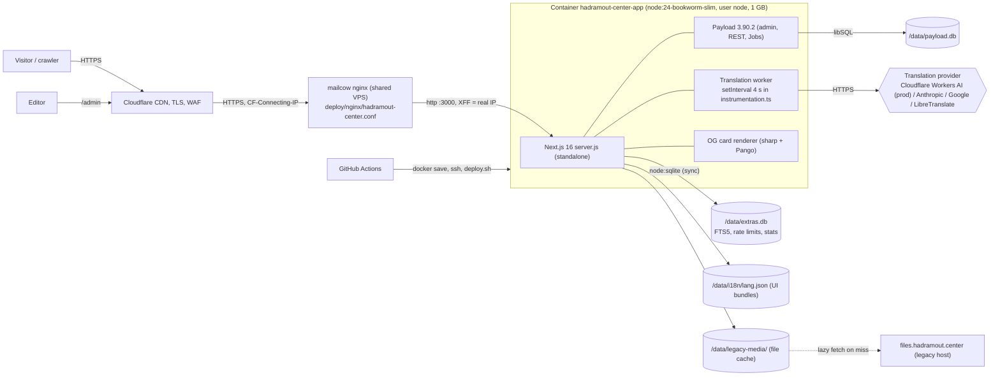
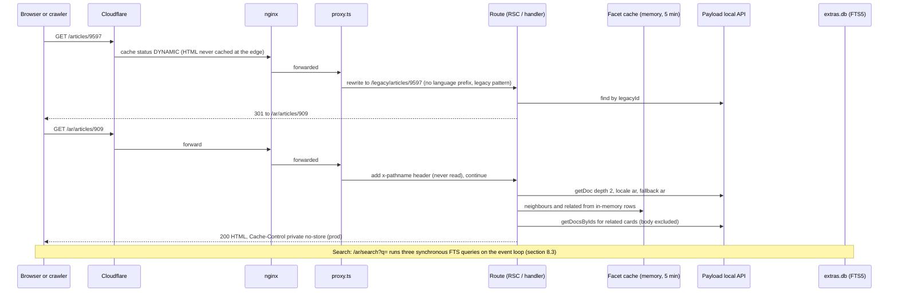
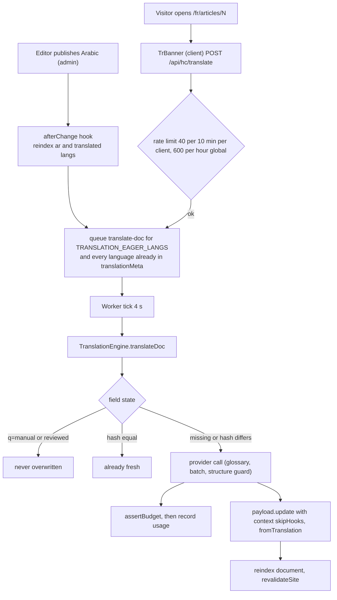

# System Architecture (verified, as built)

| | |
|---|---|
| **Purpose** | Describe the architecture that actually exists in the repository and on the live host, so that engineers, reviewers and the client's technical contacts work from verified facts rather than from the older planning documents. |
| **Scope** | `src/` (127 TypeScript modules checked for import cycles), `deploy/`, `Dockerfile`, `.github/workflows/`, `next.config.ts`, `package.json`, plus read-only GET/HEAD probes of the live host. Content correctness, visual design, SEO scoring and security penetration testing are out of scope (other audit areas). |
| **Status** | Draft for review. Supersedes the technical descriptions in `docs/02-plan/02-architecture.md` (Arabic, 2026-10-14) where they disagree; see section 12. Does not replace the framework decision record. |
| **Last updated** | 2026-10-18 |
| **Sources / evidence** | Source tree at git `master` (HEAD `d8ed733`, 10 commits ahead of `origin`); live probes of `https://hadramout-center.novixa.dev` on 2026-10-18; read-only copies of `data/payload.db` and `data/extras.db` taken to the session scratchpad (local developer snapshot, 1,454 published items); scratch scripts for import-cycle detection, dead-export detection and FTS timing. No secrets were read or recorded. |

**Observed-vs-source rule.** Every statement is tagged where it matters: **[src]** = read from the repository at HEAD, **[prod]** = observed on the live host, **[local-db]** = measured on the copied developer database. The live host is **not** running HEAD (section 2.3), so the two can differ.

Related documents: [Index](../00-INDEX.md) · [Framework decision](../02-plan/00-framework-decision.md) · [Original architecture (Arabic)](../02-plan/02-architecture.md) · [ADR log (Arabic)](../02-plan/07-decisions.md) · [i18n and translation plan](../02-plan/04-i18n-and-translation.md) · [Content model and migration](../02-plan/06-content-model-and-migration.md) · [VPS deploy guide](../05-deploy/01-vps-deploy-guide.md) · [Release readiness report](../reports/RELEASE_READINESS.md) · [Engineering standards](../../.agents/rules/engineering-standards.md) · [QA rules](../../.agents/rules/quality-assurance.md)

---

## 1. Executive summary

* One Next.js 16 process (React 19, standalone output) hosts the public site, the Payload CMS 3.90.2 admin and REST API, a set of public JSON/XML endpoints, the social-card renderer and an in-process translation worker. One container, one Docker volume `/data`, `mem_limit: 1g` (`deploy/docker-compose.yml:16`).
* Two SQLite databases with **two different engines**: Payload's `payload.db` through libSQL (`@payloadcms/db-sqlite`), and `extras.db` (full-text index, rate limits, query statistics) through the synchronous built-in `node:sqlite` (`src/db/store.ts:1`).
* Public content pages are server-rendered from Payload on every request, with a 5-minute in-memory "row cache" for list/facet logic (`src/lib/facets.ts:15`). Only pages whose sole dynamic segment is `[locale]` (home, timeline) are ISR-cached [prod]; article, book, news and list pages are `no-store` [prod].
* Arabic is the single editorial source; ~97 other languages are machine-translated on demand through a provider-agnostic engine with hash-based change detection, a human-edit lock, glossary protection and a daily character budget.
* Verdict: the layering is clean (no import cycles, strict TypeScript, no `@ts-ignore`, one sanitizer allow-list, migrations only). The material risks are operational: synchronous SQLite on the single event loop for a public search endpoint, an unbounded public Payload REST API, non-atomic translation budget accounting, no error boundaries, and documentation that still describes Fastify, Quill and Caddy. These are listed with IDs `ARCH-001..030` in section 14.

---

## 2. System context and deployment topology

### 2.1 Runtime topology [src: `deploy/`, `Dockerfile`]

| Element | Fact | Evidence |
|---|---|---|
| Image | Multi-stage: `base` -> `deps` (`npm ci`) -> `builder` (`npm run build` with placeholder env) -> `tools` (one-off: migrate, seed, import) and `runner` (copies `.next/standalone`, `.next/static`, `public`, `messages`) | `Dockerfile:1-45` |
| Runtime user | `node`, `VOLUME /data`, `HEALTHCHECK` on `/api/hc/health` every 30 s | `Dockerfile:35-41` |
| Compose | Single `app` service on external network `hadramout-center-edge`; `tools` profile for one-offs; `mem_limit: 1g`; no CPU limit; no published ports | `deploy/docker-compose.yml:6-33` |
| Reverse proxy | Shared mailcow nginx, site block installed by `deploy/server-setup.sh`; real client IP trusted only from Cloudflare ranges (`set_real_ip_from`, `real_ip_header CF-Connecting-IP`); `X-Forwarded-For` is **overwritten** with `$remote_addr`; `client_max_body_size 25m`; `proxy_read_timeout 60s`; no `limit_req`, no `proxy_cache` | `deploy/nginx/hadramout-center.conf` |
| Security headers | Set by the app, not nginx: HSTS (preload), nosniff, COOP, Referrer-Policy, Permissions-Policy, CSP on everything except `/admin` and `/api` (script-src keeps `'unsafe-inline'`) | `next.config.ts:11-33` |
| CI | `ci.yml`: typecheck, lint, unit tests, **build** on push/PR. `deploy.yml`: typecheck, lint, unit tests (no build), then Docker build in CI, `docker save | ssh docker load`, `deploy.sh` with health wait and rollback to the previous image, then a public `/api/hc/health` check | `.github/workflows/*.yml`, `deploy/scripts/deploy.sh` |
| Backup | `backup.sh`: `VACUUM INTO` for both DBs, tar of `_bk media i18n`, 14 archives kept on the same VPS; run before each deploy and from cron | `deploy/scripts/backup.sh:13-22` |

### 2.2 Technology versions [src: `package.json`]

Next.js 16.4.1, React 19.2.6, Payload and `@payloadcms/*` 3.90.2, TypeScript 5.9.3, Node >= 24 (dev machine v24.15.0), sharp 0.35.5, sanitize-html 2.18.1, `@anthropic-ai/sdk` 0.134.0, Tiptap ^3.32 (admin HTML editor only). Dependencies are pinned exactly except Tiptap (`^`).

### 2.3 Production is not HEAD [prod vs src]

| Probe (2026-10-18) | Live host | Source at HEAD | Reading |
|---|---|---|---|
| `GET /ar` response headers | `accept-ch` and `critical-ch: Sec-CH-Prefers-Color-Scheme` present | `next.config.ts:67-80` strips both outside `/admin` (commit `737f0f4`) | Client-hint fix not deployed |
| `GET /ar/articles/1` `Link` header | preloads `/fonts/plex-ar-400.woff2` | `layout.tsx:60-62` preloads `plexui-ar-400-v2.woff2` | Font/UI commit `31eb25b` not deployed |
| `GET /robots.txt` | static file: `Host: https://hadramout.center`, `Sitemap: https://hadramout.center/sitemap.xml`, no `Allow: /og/` | `src/app/robots.ts` is request-time and uses `SITE_URL` | Old build baked the Dockerfile placeholder host (`Dockerfile:13`) |
| `GET /sitemap.xml` | 1,487 `<url>` entries, host `hadramout-center.novixa.dev` | same route, request-time | consistent |

`deploy.yml` deploys on every push to `master`, so the 10 local commits are simply not pushed yet. Treat every [prod] observation in this document as describing the previous release.

---

## 3. Module map and layering [src]

135 TypeScript/TSX files under `src/` (11,074 lines excluding `payload-types.ts` and migrations); 45 are `.tsx`.

| Layer | Directory | LOC | Responsibility | Depends on |
|---|---|---:|---|---|
| Routing / delivery | `src/app` | 2,191 | `(site)/[locale]/…` pages, `(payload)` admin + REST/GraphQL wrappers, `api/hc/*`, `og/*`, `feeds/*`, `legacy*`, `sitemap.xml`, `robots.ts`, `manifest.ts` | everything below |
| Edge | `src/proxy.ts`, `src/instrumentation.ts` | 66 | language-prefix redirect and legacy rewrite; translation worker bootstrap | `lib/negotiate`, `lib/runtime` |
| Presentation | `src/components` (+ `client/` 20 islands) | 2,465 | server components for shell, cards, listings; small client islands (search box, language picker, cite panel, filters, reader settings) | `lib`, `i18n` |
| Application / data | `src/lib` (28 files) | 2,698 | Payload queries (`data`, `facets`, `reviews`, `search-page`), pure logic (`facet-core`, `list-query`, `arabic`, `dates`, `citations`), SEO (`seo`, `seo-text`, `jsonld`, `og*`), infra (`runtime`, `extras`, `ratelimit`, `legacy-media`) | `db`, `i18n`, `payload` |
| Domain config | `src/collections` (11 files), `globals`, `hooks`, `jobs` | 968 | Payload schema, access control, change hooks, translation tasks | `lib`, `i18n` |
| Translation | `src/i18n` | 1,062 | language catalog (98 rows), UI message store, engine, providers, block splitter, registry | `lib/sanitize`, `config` |
| Persistence helpers | `src/db` | 280 | `Store` over `node:sqlite`, FTS5 index operations | `lib/arabic`, `lib/sanitize` |
| Tooling | `src/importer`, `src/seed`; `scripts/` + `tests/` | 1,073; 2,233 (scripts and tests together) | legacy crawl/parse, seed, audits (a11y, SEO, Lighthouse, Arabic) | app modules |
| Generated | `src/payload-types.ts` (2,023), `src/migrations` (6 `.ts` + 2 `.json` snapshots) | | not imported by app code (see ARCH-008) | |

**Dependency direction observed.** Pages -> components -> lib -> db/i18n -> config. A script (`cycles.mjs`, run-time imports only, type-only imports excluded) found **0 import cycles in 127 modules**. Three inversions exist: `db/search.ts` imports from `lib/` (`arabic`, `sanitize`); `lib/reindex.ts` imports `hooks/content.ts`; `jobs/tasks.ts` imports `hooks/content.ts` (see ARCH-020).

### 3.1 Largest source files (excluding generated, fonts, CSS, migrations)

| LOC | File | Mixed responsibilities |
|---:|---|---|
| 485 | `src/importer/legacy.ts` | HTML parsing, cleaning, date estimation (tooling only) |
| 415 | `src/app/(site)/[locale]/[section]/[id]/page.tsx` | metadata, citation model, JSON-LD, related/neighbour loading, 7 content-type layouts, action bar |
| 286 | `src/components/Listing.tsx` | URL-state parsing, data fetch, facet UI, chips, JSON-LD, pagination |
| 250 | `src/i18n/translation/engine.ts` | loading, glossary, budget, provider calls, HTML batching, persistence |
| 240 | `src/lib/facets.ts` | cache, row projection, topics, authors, list query, neighbours, home helpers |
| 235 | `src/lib/og.ts` | layout, font shaping, cover loading, LRU |
| 234 | `src/lib/data.ts` | `Doc` type, translation status, 12 query functions |
| 223 / 222 / 211 / 210 / 208 | `Cards.tsx`, `citations.ts`, `search/page.tsx`, `[locale]/page.tsx`, `jsonld.ts` | |

Type-safety counters at HEAD: `: any` 0, `@ts-ignore/expect-error/nocheck` 0, `eslint-disable` 1 (generated file), `as never` 44, `as unknown as` 33 (migrations excluded), `'use client'` files 20 (all under `components/client/` or `admin/`).

---

## 4. Request flow [src, confirmed by prod probes]

Key behaviours:

1. **Language edge** (`src/proxy.ts`): requests without a language prefix are redirected (`307`) to the cookie language `hc_lang` or `DEFAULT_LANG`; `Accept-Language` is deliberately ignored (`src/lib/negotiate.ts:13-22`). Legacy detail URLs (`/articles/123`) are rewritten to `/legacy/...`; legacy list URLs and `/about` get a `308`.
2. **Site routes** live under `src/app/(site)/[locale]/`: `page.tsx` (home), `[section]/page.tsx` (7 list types, or a CMS page via `StaticPage` when the segment is not a content route), `[section]/[id]/page.tsx` (detail), `search`, `authors`, `authors/[id]`, `topics`, `topics/[id]`, `timeline`, `contact`, `saved`. The `[locale]` layout validates the language against `ENABLED_LANGS`, renders `<html lang dir>`, and loads site settings.
3. **Endpoints**: `/api/hc/{translate,suggest,contact,subscribe,reviews,ics/[kind]/[id],health}`, `/og/[lang]/[kind](/[id])`, `/feeds/[lang]/[file]`, `/sitemap.xml`, `/robots.txt`, `/manifest.webmanifest`, `/legacy-media/[...path]`, `/legacy/[section]/[id]`, plus everything Payload mounts under `/api/*` and `/admin`.
4. **Errors**: there is no `error.tsx` or `global-error.tsx` in `src/app` (glob, 2026-10-18); only two `not-found.tsx` files exist. `getDoc` and `getAuthor` convert every exception into `null`, which the page renders as `404` (`src/lib/data.ts:125-130, 203-208`).

---

## 5. Rendering and caching strategy

### 5.1 Observed behaviour per route family

| Route family | Mode | Prod `Cache-Control` / header (2026-10-18) | Why [src] |
|---|---|---|---|
| `/{lang}` (home) | ISR, on-demand | `s-maxage=300, stale-while-revalidate=31535700`, `x-nextjs-cache: HIT` | only dynamic segment is `[locale]`; layout `generateStaticParams() => []`, `revalidate = 300` (`layout.tsx:13-18`) |
| `/{lang}/timeline` | ISR | same, `x-nextjs-cache: STALE` | same |
| `/{lang}/articles/{id}` (and all detail pages) | dynamic SSR | `private, no-cache, no-store, max-age=0, must-revalidate` | extra dynamic segments `[section]/[id]` with no `generateStaticParams` |
| `/{lang}/{section}` lists, `/search`, `/authors`, `/contact`, topic pages | dynamic SSR | same `no-store` | read `searchParams` or have extra segments |
| `/{lang}/topics` | dynamic SSR [prod] | `no-store` | **unexplained**: the page at HEAD reads no dynamic API; probably an older prod build (verify with the build route table, ARCH-002) |
| `/sitemap.xml` | request-time with 1 h module cache | `public, max-age=3600, s-maxage=3600` | `sitemap.xml/route.ts:33-37` |
| `/feeds/...` | request-time | `public, max-age=900` | |
| `/og/...` | request-time, 80-entry in-memory LRU, 2 concurrent renders | `public, max-age=86400, s-maxage=2592000, swr=86400` | `lib/og.ts`, `lib/og-render.ts` |
| `/legacy-media/...` | file cache on `/data` | `public, max-age=31536000, immutable` | `app/legacy-media/[...path]/route.ts:10` |

Cloudflare reports `cf-cache-status: DYNAMIC` for every HTML response, so the CDN never serves HTML. The effect of the missing ISR on content pages: TTFB from the audit machine was 0.62-0.81 s for `/ar/articles/1` (3 samples) versus 0.45-0.60 s for the cached home page, so roughly +0.2 s of origin work per request on top of network latency (indicative only; one vantage point).

### 5.2 Caches and their invalidation

| Cache | Location | TTL / bound | Invalidated by | Notes |
|---|---|---|---|---|
| Next.js ISR | `.next` inside the container | 300 s | `revalidatePath('/', 'layout')` in `hooks/revalidate.ts` | container filesystem, lost on every deploy |
| Facet rows, topics, author names | `globalThis.__hcFacets` Map | 5 min, key set bounded (7 types + per-language topics/authors) | `revalidateSite()` clears everything | single process only; `getRows` selects 5-12 fields per document, `limit: 5000` |
| React `cache()` | per request | request | n/a | `getDoc`, `getSite` deduplicate `generateMetadata` and the page |
| UI messages | module `Map` in `i18n/ui-store.ts` | until file mtime changes | file write by translate-ui job | 8 `existsSync/statSync` calls per `makeT()` |
| Sitemap | module variable | 1 h | none | |
| OG PNG | LRU of 80 `Buffer`s | LRU | version `?v=updatedAt` in URL | |
| Rate-limit buckets | `extras.db` | window rows pruned randomly (1 % of calls) | n/a | |

Invalidation hooks exist on content collections, authors, categories, pages, timeline, reviews, the site global and both translation tasks. Deletes of authors/categories/pages/timeline entries do not revalidate. Every translation write also calls `revalidateSite()` (ARCH-015).

---

## 6. Data layer

### 6.1 Payload collections [src: `src/payload.config.ts`, `src/collections/*`]

| Group | Slugs | Access (read / create / update / delete) |
|---|---|---|
| Content (7) | `news, articles, books, magazines, events, forum-events, videos` | published only for anonymous, all for staff / editor+admin / any staff / admin |
| Taxonomy | `authors` (read public), `categories` (two levels, `kind` article or book), `timeline`, `pages` | `contentAccess`; `authors` and `categories` read open |
| System | `media` (read public), `glossary` (staff), `users`, `translation-usage` (read staff; create/update blocked, engine uses `overrideAccess`) | |
| Forms | `messages`, `subscribers` (create `() => false`, written by server routes with `overrideAccess: true`), `reviews` (editor+admin, created pending) | |
| Global | `site` | read public, update editor+admin |

Common fields (`collections/shared.ts:64-171`): localized `title/excerpt/body`, `cover` upload plus `coverUrl` (legacy image URL), `coverAlt`, `status` (draft/published/archived), `featured`, `publishedAt` + `datePrecision`, `legacyId` (unique), `legacyUrl`, `source`, `edited`, hidden JSON `translationMeta`. `body` is a `textarea` whose admin component is a Tiptap editor (`src/admin/fields/HtmlField.tsx`); it is sanitized in a `beforeValidate` hook. Roles: admin, editor, reviewer (reviewers can write only non-Arabic locales).

Configuration facts: `localization.locales` = all 98 catalog rows with `fallback: true`; `push: false` plus `prodMigrations` (6 migrations, run at start in production); no `versions`/drafts feature (draft is a status value); `jobs.deleteJobOnComplete: true`; **no `maxDepth`, collection `maxLimit` or `graphQL` limits are configured** (ARCH-004).

### 6.2 Snapshot of the local developer database [local-db, copy taken 2026-10-18]

| Table | Rows | | Table | Rows |
|---|---:|---|---|---:|
| articles | 909 | | authors | 274 |
| news | 387 | | categories | 53 |
| books | 52 | | pages | 4 |
| events | 53 | | timeline | 6 |
| magazines | 40 | | glossary | 28 |
| forum_events | 11 | | users | 1 |
| videos | 2 | | media | **0** |

Total published content 1,454 (matches the migrated count stated in the brief). Only the `ar` locale has rows (no translations in the local copy); `payload_jobs` empty; 162 indexes; the largest Arabic article body is 82,785 characters. **[prod]** `GET /api/media?limit=1` returns `totalDocs: 0` as well, i.e. the Payload media collection is unused in production: all images are served from the `/data/legacy-media` file cache (section 9).

### 6.3 `extras.db` [src: `src/lib/extras.ts`, `src/db/search.ts`]

| Table | Purpose | Written by | Status |
|---|---|---|---|
| `search_index` (FTS5, `unicode61 remove_diacritics 2`; columns title, excerpt, body, authors, stems; UNINDEXED lang, doc_id, kind) | one row per (document, language); rowid = `(docId*16 + kindSlot)*128 + langSlot` so a document's rows are replaced by an indexed range delete | `hooks/content.ts`, `jobs/tasks.ts`, `lib/reindex.ts` | live; 1,454 rows, all `ar` [local-db] |
| `rate_limits` | fixed-window counters (`allow()`), keyed by a daily-salted hash of the client IP | public POST routes, `/og` | live |
| `search_queries` | per-day query statistics used for "popular searches" | `recordSearch()` during `/search` render | live, never pruned |
| `pageviews`, `not_found_log` | anonymous counters | **nothing** | dead schema (grep: no writer) |

The index is derived data and fully rebuildable (`reindexAll`). Arabic normalization (alef/yeh/teh-marbuta unification, diacritics, tatweel, Arabic-Indic digits) and clitic stripping live in `src/lib/arabic.ts` and are applied identically at index and query time.

### 6.4 Faceted archive

`src/lib/facet-core.ts` (pure, unit-tested) filters, sorts and counts in memory; `src/lib/facets.ts` loads one compact row per published document (`select` of ≤12 fields) and caches it for 5 minutes. Facet counts are exact and disjunctive. List pages then fetch only the visible page of documents with `select: { body: false }`. This design is sound for about 1.5k documents (rows are a few hundred KB); the cap `limit: 5000` per type silently truncates beyond that (latent).

### 6.5 Query patterns reviewed

| Pattern | Where | Assessment |
|---|---|---|
| List pages | `queryArchive` -> rows (cache) + one `find` by ids | good: no N+1, no body |
| Detail page | `getDoc` (depth 2) + cached rows + one `find` for neighbours/related + reviews query (limit 200) | acceptable |
| Typeahead | `api/hc/suggest/route.ts:17-26` | **N+1**: one `findByID` per suggestion (up to 8) plus an FTS query; no rate limit |
| Search | `search-page.ts:42-71` | three FTS statements (count, top-1000 ranking, per-kind counts) per request, synchronous (ARCH-001) |
| Reindex of one document | `hooks/content.ts:15-41` | 1 + L `findByID` calls (L = translated languages); each translate job re-runs it -> O(L²) per document across all languages |
| `listAuthors` | recomputed per call from cached rows | fine |
| Sitemap | 7 `find` calls with `limit: 5000` and a full `select` of `translationMeta` | fine at current size |

---

## 7. Translation engine

### 7.1 Components [src: `src/i18n/translation/*`, `src/jobs/tasks.ts`, `src/hooks/content.ts`]

| Piece | File | Role |
|---|---|---|
| Registry | `registry.ts` | which fields of which collection are translatable and whether `text` or `html` |
| Engine | `engine.ts` | `translateDoc(slug, id, lang)`: loads Arabic source and current target (no fallback), decides per field using `translationMeta[lang][field] = {h, q, p, m, at}` |
| Providers | `providers.ts`, `anthropic.ts`, `cloudflare.ts` | `none`, `mock` (dev only, rejected in production), `anthropic`, `google`, `libretranslate`, `cloudflare` (Workers AI, Mistral Small 3.1 by default) |
| Blocks | `blocks.ts` | HTML split into blocks, batching, tag-structure guard (`sameStructure`), glossary protection, placeholder masking |
| UI strings | `ui-store.ts`, `translateUi` | `messages/ar.json` (353 keys) and `en.json` are committed; other languages are machine bundles in `$DATA_DIR/i18n/<lang>.json` with per-key hashes |
| Budget | engine `assertBudget/record` + `translation-usage` collection | daily characters-in cap (`TRANSLATION_DAILY_CHAR_LIMIT`, default 2,000,000; `enable-translation.sh` sets 200,000 for the free Cloudflare tier) |
| Queue | Payload Jobs, queue `translation`, tasks `translate-doc` and `translate-ui`, 5 attempts, exponential back-off from 30 s | |
| Worker | `instrumentation.ts` | `setInterval` every 4 s, `busy` flag, runs `payload.jobs.run({queue:'translation', limit: TRANSLATION_CONCURRENCY})`; skipped when provider is `none` or `PAYLOAD_DISABLE_AUTORUN=1` |

### 7.2 Flow

Correctness properties verified in code: human edits in a non-Arabic locale flip the field to `manual` (`hooks/content.ts:55-69`); `translateDoc` treats a pre-existing target value without metadata as manual (`engine.ts:162-166`); translated HTML is re-sanitized (`engine.ts:133`); a truncated batch is split in halves (`engine.ts:111-114`); the page shows Arabic plus a banner until `title` (and `body` when present) is translated (`lib/data.ts:41-58`).

### 7.3 Known weaknesses (detail in section 14)

* `TranslationError.retryable` is set in many places and read nowhere: Payload retries every failure 5 times, including "language not enabled", "model declined" and "daily limit reached"; a job that exhausts its attempts is not re-queued on the next day (ARCH-009).
* Budget check and usage update are separate, non-atomic operations on a collection with a unique `key`; a unique-violation after a paid provider call fails the job and the retry pays again (ARCH-010).
* `POST /api/hc/translate` is unauthenticated, accepts any numeric id (also unpublished or non-existent) and any translatable slug; a script can exhaust the day's budget and the global rate bucket (ARCH-011).
* "Translation complete" is computed in four places with different rules (ARCH-012).
* No automated test touches the engine, providers or block splitter (ARCH-019).

---

## 8. Jobs, background work and process model

| Work | Where it runs | Blocking? |
|---|---|---|
| Translation jobs | same Node process, `setInterval` in `instrumentation.ts` | network-bound but also CPU for sanitize and **synchronous** FTS reindex |
| FTS queries and writes | `node:sqlite` `DatabaseSync` on the request thread | **yes, synchronous** |
| OG rendering | sharp (libvips threads), max 2 concurrent by a hand-written semaphore (`og-render.ts:3-15`, which can briefly allow a third) | native threads, results LRU-cached |
| Legacy image fetch + write | request handler, 20 s timeout, 25 MB cap | async |
| Daily backup | host cron running `docker exec` | out of process |

### 8.3 Measured cost of synchronous FTS [local-db, Windows developer machine, copy of `extras.db`]

| Query (as built by `toFtsQuery`) | count | top-1000 rank | per-kind counts | Total blocking per `/search` request |
|---|---:|---:|---:|---:|
| `"تاريخ"*` | 70 ms | 96 ms | 56 ms | **222 ms** |
| `"حضرموت"*` | 64 ms | 95 ms | 86 ms | **246 ms** |
| `"م"*` (one letter) | 183 ms | 223 ms | 154 ms | **560 ms** |
| `"ا"*` (one letter) | 363 ms | 653 ms | 387 ms | **1,403 ms** |
| typeahead `title : ("ال"*)` | | | | 151 ms avg, plus up to 8 Payload reads |

Absolute numbers will differ on the VPS, but the shape is the issue: every statement runs on the one event loop that also serves all pages, the admin and the worker. `/search` and `/api/hc/suggest` are public and not rate-limited. Live probe: `/ar/search?q=ا` TTFB 0.99 s versus 0.73 s for `تاريخ` from the same vantage point.

---

## 9. Legacy redirect and media proxy

* **Redirect map.** `src/proxy.ts` rewrites `/news|articles|books|magazines|events|forum|videos/{id}` to `/legacy/{section}/{id}`; the route (`src/app/legacy/[section]/[id]/route.ts`) looks up `legacyId` and answers `301` to `/{lang}/{route}/{newId}`, or `302` to the section list when unknown. [prod] `GET /articles/9597` -> `301 https://hadramout-center.novixa.dev/ar/articles/909`. The language comes from the `hc_lang` cookie (unvalidated `[\w-]+`) rather than being fixed, so the permanent redirect target varies per visitor (ARCH-021). The unprefixed list URLs and `/about` get `308`.
* **Image proxy.** Bodies and covers reference `https://files.hadramout.center/media/...`; `localizeLegacyMedia()` rewrites these to `/legacy-media/...` at render time. The route validates the path (character allow-list, no dot segments, extension allow-list, must stay inside `$DATA_DIR/legacy-media`), serves from disk, or on a miss fetches from the legacy host (`redirect: 'error'`, 20 s timeout, image or PDF only, 25 MB cap), writes atomically and serves. Images then pass through `next/image` (`/_next/image?url=%2Flegacy-media%2F...`). PDFs of books and magazines are linked directly to their original hosts (`doc.pdf`), not proxied.
* **Weaknesses.** Entire files are buffered in memory (`readFile`), no `ETag`/`Range`; unknown paths cause an upstream request every time (no negative cache, no rate limit); the cache directory is **not** in the backup archive (ARCH-013, ARCH-022).

---

## 10. Configuration and environment

`src/config.ts` is the typed, validated configuration (`loadConfig`), with `appConfig()` as the memoized accessor (two copies: `lib/runtime.ts` and `lib/runtime-light.ts`). Twelve call sites use `loadConfig()` (re-parsed each call, including per request in `proxy.ts`) and twelve use `appConfig()`.

| Variable | Read in | Notes |
|---|---|---|
| `PAYLOAD_SECRET` | `payload.config.ts:39` (`|| ''`), `lib/ratelimit.ts:20` | not validated in code; `deploy.sh` checks length >= 32 |
| `DATABASE_URL` | `payload.config.ts:43`, `scripts/import-images.ts` | |
| `DATA_DIR` | `config.ts:81`, `lib/extras.ts:35`, `lib/legacy-media.ts:17`, `i18n/ui-store.ts:17` | **four readers, three semantics** (`??`, `||`, `resolve`); `Config.dataDir` is never used |
| `MEDIA_DIR` | `collections/Media.ts:10`, `lib/og.ts` | outside `config.ts` |
| `SITE_URL`, `DEFAULT_LANG`, `ENABLED_LANGS`, `INDEXABLE_LANGS` | `config.ts` | |
| `TRANSLATION_*`, `ANTHROPIC_API_KEY`, `CLOUDFLARE_*`, `GOOGLE_TRANSLATE_API_KEY`, `LIBRETRANSLATE_*` | `config.ts` | provider-specific required keys validated at load; default model `claude-opus-5-5` (`config.ts:90`) only applies to the `anthropic` provider |
| `PAYLOAD_DISABLE_AUTORUN`, `NEXT_RUNTIME`, `NEXT_PHASE` | `instrumentation.ts` | |
| `GOOGLE_SITE_VERIFICATION`, `BING_SITE_VERIFICATION`, `HC_SQL_LOG` | `layout.tsx:41`, `payload.config.ts:47` | missing from `.env.example` |
| `ADMIN_EMAIL`, `ADMIN_PASSWORD` | `scripts/seed.ts` | first-install only |

---

## 11. Conformance to `AGENTS.md` and `.agents/rules`

| Rule | Verdict | Evidence |
|---|---|---|
| Stack and commands in `AGENTS.md` | Matches | `package.json` scripts `check`, `db:seed`, `payload`; Node 24; layout as described |
| 1. Arabic is the source language; manual edits never overwritten | Met | `hooks/content.ts:55-69`, `engine.ts:160-166` |
| 2. No invented institutional data | Not assessed here (content audit) | |
| 3. Rich text sanitized everywhere it enters the DB; no unsanitized `dangerouslySetInnerHTML` | Met on write paths | single allow-list `lib/sanitize.ts`; `cleanBody` on body fields and pages; engine re-sanitizes; the 11 `dangerouslySetInnerHTML` uses are JSON-LD (escaped `<>&`), a static theme snippet, and sanitized bodies. Direct SQL migrations bypass hooks (low) |
| 4. Logical CSS only | Mostly met | physical `left` in `styles/components.css:223` and `components/client/LangPicker.tsx:133`; `pages.css:151` is intentionally `direction: ltr` |
| 5. Performance budget | HTML within budget: `/ar/articles/1` = 107,599 B raw, **24,548 B gzip** [prod]; first-load JS not measured here | |
| 6. Accessibility | Out of scope | |
| 7. SEO (canonical, hreflang only for complete translations, noindex partial) | Implemented in `lib/seo.ts`; correctness depends on the duplicated "complete" rules (ARCH-012) | |
| 8. CSP, headers, rate limits on every public write, honeypot, roles | Mostly met; public write routes are limited and honeypotted, but `/api/hc/translate` is spendable by anonymous scripts and Payload's own `/api/*` has no limits (ARCH-004, ARCH-011) | |
| 9. Cost guard | Partially met: cap exists, accounting is racy and exhaustible (ARCH-010/011) | |
| 10. Schema changes via Payload migration | Met | `push: false`, `prodMigrations`, 6 migrations (`payload.config.ts:45-46`). Whether generated schema equals the migrations is NOT VERIFIED (needs `payload migrate:status`/`generate`) |
| QA: tiers 1-6 | Tier 4 missing: `npm run test:int` points to `tests/integration/**` which does not exist | `package.json:27`, `git ls-files tests` |
| QA: never report "100%" without a measurement | Not assessed | |

---

## 12. Contradictions: `docs/02-plan/02-architecture.md` versus reality

| # | Document says | Reality | Evidence |
|---|---|---|---|
| 1 | Next.js "(Server Components, ISR)" and section 6 "ISR ... caching in Cloudflare" | ISR only for pages whose sole dynamic segment is `[locale]`; content and list pages are `no-store`; Cloudflare status DYNAMIC for all HTML | section 5.1 [prod] |
| 2 | Translation providers "Claude / Google / LibreTranslate" | six provider names; production uses Cloudflare Workers AI; Claude is opt-in; `mock` is rejected in production | `config.ts:7,72`, `providers.ts:94-110`, `enable-translation.sh` |
| 3 | Images: "`next/image` + Payload media collection with multiple sizes" | Payload `media` has 0 rows locally and on prod; images are a disk cache of the legacy host under `/data/legacy-media` | `GET /api/media` `totalDocs 0`; `app/legacy-media` |
| 4 | Collections list omits `reviews` | `reviews` (reader reviews, moderated) exists with its own route and migration | `collections/Reviews.ts`, `api/hc/reviews` |
| 5 | `app/api/hc/` = translate, suggest, contact, subscribe, health | also `reviews` and `ics/[kind]/[id]`; plus `og/`, `legacy-media/`, `feeds/`, `sitemap.xml/` | `find src/app` |
| 6 | Repository layout lists `lib/` as 10 modules | 28 files; also `src/db`, `src/importer`, `src/seed`, `src/admin`, `src/proxy.ts`, `src/instrumentation.ts` not listed | section 3 |
| 7 | `extras.db`: "anonymous counters" for views | `pageviews` and `not_found_log` tables are created but never written | `lib/extras.ts:16-27`, grep |
| 8 | Not mentioned | translation worker runs inside the web process via `instrumentation.ts` | `instrumentation.ts` |
| 9 | Scripts "import-legacy · seed · build-brand" | also `import-images`, `a11y`, `arabic-audit`, `lighthouse`, `seo-audit`, `bench`, `smoke-prod.sh` | `scripts/` |
| 10 | Security summary: "جلسات بكوكي HttpOnly، قفل الحساب بعد 5 محاولات" | lockout (5 attempts, 15 min) is in `Users.ts:12-13`; cookie flags are Payload defaults plus `secure` in production; consistent | `collections/Users.ts:10-15` |

The Arabic document remains useful for rationale, hosting history and the content model; it should carry a banner pointing here.

---

## 13. ADR index

Existing log: [`docs/02-plan/07-decisions.md`](../02-plan/07-decisions.md) (15 entries, Arabic). Status below is the result of checking each decision against the code on 2026-10-18. The log itself was **not** edited (out of scope for this audit).

| ADR | Decision (short) | Status verified | Evidence / replacement |
|---|---|---|---|
| ADR-01 | SSR + SQLite instead of a static site | **Valid** | Next SSR, SQLite |
| ADR-02 | Node 24 + native TypeScript type stripping, `node:sqlite` | **Partly valid** | scripts run with type stripping (`package.json` `import:*`), app is built by Next, `node:sqlite` only backs `extras.db` and backups; Payload uses libSQL |
| ADR-03 | Fastify 5 | **Superseded** | [00-framework-decision.md](../02-plan/00-framework-decision.md): Next.js 16 + Payload 3 |
| ADR-04 | Language sub-folders `/{lang}/` | **Valid** | `proxy.ts`, `[locale]` routes |
| ADR-05 | Server-side translation with persistent memory | **Valid** | `translationMeta` hashes in the DB |
| ADR-06 | Translate on demand, not all 90 languages up front | **Valid** | eager languages + `/api/hc/translate` |
| ADR-07 | Never translate from GET | **Valid, with a gap** | translation starts only from POST, but the POST is anonymous (ARCH-011) |
| ADR-08 | UI without a JS framework | **Superseded** | React 19 + 20 client islands |
| ADR-09 | Official brand colours | Not assessed | design audit |
| ADR-10 | Docker + Caddy | **Superseded** | Docker + shared mailcow nginx behind Cloudflare (`deploy/nginx`, `server-setup.sh`) |
| ADR-11 | Content snapshot committed to the repo | **Valid** | `content/legacy-snapshot.json.gz` (5.9 MB with folder) |
| ADR-12 | Quill editor | **Superseded** | Tiptap in `src/admin/fields/HtmlField.tsx` |
| ADR-13 | No-fabrication policy enforced by checks | Policy valid; enforcement not audited here | importer/seed |
| ADR-14 | Branch + PR + CI before merge | **Not followed as written** | `deploy.yml:6-8` deploys every push to `master`; recent history is direct commits |
| ADR-15 | Latin digits in all languages | Not assessed | |

Decisions that exist only in code and need an ADR (status BACKLOG, see ARCH-018):

| Proposed | Decision to record | Status |
|---|---|---|
| ADR-16 | Payload as CMS inside the Next.js process (record already exists as a framework decision, add to the log) | BACKLOG |
| ADR-17 | Two SQLite files and two engines: Payload/libSQL for source of truth, `node:sqlite` for derived data; rebuild and backup rules | BACKLOG |
| ADR-18 | Translation worker in the web process via `instrumentation.ts`; criteria for splitting it into a separate container | BACKLOG |
| ADR-19 | In-memory facet rows with 5-minute TTL instead of per-request queries; size limit and invalidation | BACKLOG |
| ADR-20 | Cloudflare Workers AI as default provider and the daily character cap policy | BACKLOG |
| ADR-21 | Legacy media served from a disk cache of the old host; retirement plan for `files.hadramout.center` | BACKLOG |
| ADR-22 | Public Payload REST/GraphQL exposure policy | BACKLOG |

---

## 14. Findings and task backlog

Severity per the audit guide. Every task starts as BACKLOG. Acceptance criteria and verification methods are in section 14.1. Effort: S = under a day, M = 1-3 days, L = about a week.

| ID | Severity | Title | Evidence (short) | Task status |
|---|---|---|---|---|
| ARCH-001 | high | Synchronous FTS on the single event loop behind public, unlimited search and typeahead | `db/store.ts:1`, `db/search.ts:101-109`; 222-1,403 ms blocking per search [local-db] | BACKLOG |
| ARCH-002 | medium | Content and list pages are not cached; ISR claim only holds for home and timeline | prod `Cache-Control: private, no-store` on `/ar/articles/1`; `x-nextjs-cache: HIT` on `/ar` | BACKLOG |
| ARCH-003 | medium | Production runs a build older than HEAD | prod `Accept-CH`, static `robots.txt` with `hadramout.center` host | BACKLOG |
| ARCH-004 | medium | Public Payload REST API has no depth/limit ceiling | `/api/articles?limit=20&depth=0` = 489,464 B in 3.55 s | BACKLOG |
| ARCH-005 | medium | `getDoc`/`getAuthor` turn every error into a 404 | `lib/data.ts:125-130, 203-208` | BACKLOG |
| ARCH-006 | medium | No error boundaries, 45 empty catch blocks, no telemetry | glob `error.tsx`, grep `catch {` | BACKLOG |
| ARCH-007 | medium | ESLint ignores project rules for all `.tsx` and has no React/Next/a11y plugins | `eslint.config.js:10` | BACKLOG |
| ARCH-008 | medium | Generated Payload types are unused; 77 casts and an index-signature `Doc` | `grep payload-types`, `lib/data.ts:26` | BACKLOG |
| ARCH-009 | medium | Retry policy ignores `retryable`; budget-exhausted jobs die permanently | `jobs/tasks.ts:26`, `types.ts:35` | BACKLOG |
| ARCH-010 | medium | Translation budget accounting is racy and can double-bill | `engine.ts:82-98`, `Forms.ts:67` | BACKLOG |
| ARCH-011 | medium | Anonymous POST can exhaust the daily translation budget | `api/hc/translate/route.ts:45-73`, `enable-translation.sh` cap 200,000 | BACKLOG |
| ARCH-012 | medium | "Translation ready/complete" implemented four times | `data.ts:41`, `[id]/page.tsx:37`, `StaticPage.tsx:10`, `sitemap.xml/route.ts:61` | BACKLOG |
| ARCH-013 | medium | Backup can silently omit i18n bundles and always omits the image cache | `deploy/scripts/backup.sh:20` | BACKLOG |
| ARCH-014 | low | Search index maintenance gaps (author rename, `pages` kind, O(L²) reindex) | `Authors.ts:11-16`, `db/search.ts:14`, `hooks/content.ts:15-41` | BACKLOG |
| ARCH-015 | medium | Every translation write purges all caches; purge may silently fail in the worker | `jobs/tasks.ts:43,59`, `hooks/revalidate.ts:7-15` | BACKLOG |
| ARCH-016 | low | Dead and duplicated code (verified list) | section 15 | BACKLOG |
| ARCH-017 | low | Configuration not centralised; `loadConfig()` re-parsed per call | section 10 | BACKLOG |
| ARCH-018 | medium | Architecture and ADR docs describe Fastify, Quill, Caddy and ISR | section 12-13 | BACKLOG |
| ARCH-019 | medium | No tests for translation engine, hooks, rate limit, proxy, routes; no integration tier | `git ls-files tests`, `package.json:27` | BACKLOG |
| ARCH-020 | low | Mixed-responsibility files and a grab-bag `lib/` | section 3.1 | BACKLOG |
| ARCH-021 | low | Legacy 301 depends on a cookie; proxy skip pattern lacks boundaries | `legacy/.../route.ts:13,19`, `proxy.ts:10` | BACKLOG |
| ARCH-022 | low | Legacy media route buffers whole files and re-fetches misses | `legacy-media/[...path]/route.ts:31-45` | BACKLOG |
| ARCH-023 | low | Health endpoint leaks error text and whether any user exists; first-user bootstrap is open when users = 0 | `health/route.ts:13-15`, `Users.ts:18-22` | BACKLOG |
| ARCH-024 | low | `search_queries` grows without bound and feeds public "popular searches" | `search-page.ts:83-88`, `db/search.ts:123` | BACKLOG |
| ARCH-025 | low | Image optimizer cache lives in the container filesystem | `Dockerfile:35-36` (volume `/data` only) | BACKLOG |
| ARCH-026 | low | CI duplication and missing gates | `ci.yml` + `deploy.yml` both on push master; deploy `check` has no build | BACKLOG |
| ARCH-027 | low | Two physical-direction CSS exceptions | `components.css:223`, `LangPicker.tsx:133` | BACKLOG |
| ARCH-028 | info | Capacity: web, admin, worker, OG and FTS share one 1 GB process with no runtime heap cap | `docker-compose.yml:15`, `instrumentation.ts` | BACKLOG |
| ARCH-029 | info | `node:sqlite` is a second SQLite stack with its own stability status | `db/store.ts:1` | BACKLOG |
| ARCH-030 | info | Conformance summary: what is already good | section 11 | n/a |

### 14.1 Recommendation, acceptance criteria and verification

| ID | Recommendation | Acceptance criteria | Verification method | Effort |
|---|---|---|---|---|
| ARCH-001 | Require at least 2 characters per prefix token; rate-limit `/search` and `/api/hc/suggest` with `allow()`; replace the three statements with one query and cache results per (q, lang, kind) for 60 s; move FTS to a worker thread or an async client; replace the per-suggestion `findByID` loop with one `find` using `id in`. | A one-letter query returns quickly without scanning; 30 concurrent `/search` requests do not raise the p95 of `/ar/articles/1` above 2x idle; suggest issues at most 2 queries. | Repeat the `fts.mjs`-style timing on a DB copy; load a staging copy with 30 parallel search requests while sampling an article TTFB; unit test for the token-length rule. | M |
| ARCH-002 | Add `generateStaticParams` returning `[]` and a `revalidate` value to `[section]/[id]`, `topics/[id]`, `authors/[id]`; or send `s-maxage` + stale-while-revalidate for detail pages and add a Cloudflare cache rule. | Build route table shows detail routes as ISR; second request to `/ar/articles/1` has `x-nextjs-cache: HIT` and a public `s-maxage`; admin edits appear within the revalidate window or immediately via revalidation. | `next build` route summary; `curl -I` twice on a deployed build; edit-and-reload test. | M |
| ARCH-003 | Push and deploy HEAD after the release checklist, then re-run the same probes; add a post-deploy smoke step that compares the `robots.txt` host and checks the absence of `Accept-CH`. | `/robots.txt` host equals `SITE_URL`; `/ar` has no `accept-ch`/`critical-ch`; font preload path is `plexui-ar-*-v2`. | `curl -sI` and `curl -s /robots.txt` against the live host. | S |
| ARCH-004 | Set `maxDepth`, per-collection `maxLimit`/`defaultLimit`, disable GraphQL if unused, and block `/api/*` except `/api/hc/*` and authenticated admin traffic at nginx or in `proxy.ts`; hide `/api/access`. | Anonymous `GET /api/articles?limit=1000` returns 403 or at most the configured limit; `/api/access` not public; site and admin still work. | `curl` the same URLs as in the evidence; admin smoke test. | S |
| ARCH-005 | Return `null` only for Payload "not found"; rethrow all other errors; add `error.tsx` and `global-error.tsx`. | A forced DB failure yields HTTP 500 and a log line, not 404. | Unit test with a stubbed Payload that throws; manual test with a locked DB copy. | S |
| ARCH-006 | Add `error.tsx` (site) and `global-error.tsx`, structured logging for the empty catches that matter (translation, reindex, revalidate), and an error reporter. | Throwing from a page renders the branded error page; each swallowed failure class logs once. | Throw in a test route; count of empty `catch {}` reduced, each remaining one commented. | M |
| ARCH-007 | Change lint globs to `**/*.{ts,tsx,mjs}`, remove the dead `client/**` block, add `eslint-plugin-react-hooks`, `@next/eslint-plugin-next`, `jsx-a11y`. | `npm run lint` fails on a deliberately unused import in a `.tsx` file and on a conditional hook. | Add and revert a canary violation; CI green afterwards. | S |
| ARCH-008 | Use generated `payload-types` (or small hand-written view types) for `find` results; remove the `Doc` index signature; replace `as never` with typed `select`/`locale` helpers. | `as never` count under 10; `Doc` has no index signature; typecheck passes. | `grep -c` counters; `npm run typecheck`. | M |
| ARCH-009 | Make tasks stop retrying non-retryable `TranslationError`s; on "daily limit", reschedule the job for 00:05 UTC; add a nightly requeue of failed `translate-doc` jobs. | A "model declined" job fails once; a limit-hit job completes the next day without manual action. | Unit test with `MockProvider` throwing both kinds; inspect `payload_jobs` after a simulated midnight. | M |
| ARCH-010 | Move usage counters to `extras.db` with one atomic `INSERT ... ON CONFLICT DO UPDATE` and reserve characters before the call; refund on failure; count output characters if the provider bills them. | Two concurrent jobs never exceed the limit by more than one batch; no unique-key exception after a provider call. | Concurrency test with 10 parallel `call()`s on `MockProvider`; check totals. | M |
| ARCH-011 | Require a signed short-lived token minted by the page render for translation requests; ignore unpublished or non-existent ids; split the global bucket (per language, per slug) and reserve a budget share for editor-triggered jobs. | A script POSTing random ids queues nothing; an unpublished id returns `none`; editor eager jobs still run after a flood test. | Scripted POST test on the team's own staging environment only; budget table before and after. | M |
| ARCH-012 | One `translationState(doc, lang)` function in `lib/` used by page metadata, `TrBanner` props, the sitemap and `/api/hc/translate`. | The four callers import the same function; the hreflang set in the page head equals the sitemap alternates for a sample of 20 documents. | Unit tests with fixtures (with and without body); diff of sitemap vs page head for 20 URLs. | S |
| ARCH-013 | Always include `legacy-media` and `i18n` (create directories if missing, or tar each path separately); copy archives off-site; add a restore test to the runbook. | Archive listing contains `payload.db`, `extras.db`, `i18n/`, `legacy-media/`; a restore on a scratch volume serves an image. | `tar tzf` on a fresh backup; run `restore.sh` on a scratch host. | S |
| ARCH-014 | Reindex the works of an author when the author changes; drop the unused `pages` kind or index pages deliberately; reindex only the translated language in `translate-doc`. | Renaming an author changes search results for their works; a translate job issues 2 reads, not 1 + L. | Integration test; query counter with `HC_SQL_LOG=1`. | M |
| ARCH-015 | Use tag-based revalidation with debounce; skip `revalidateSite()` for translation writes unless the document is already public in that language; log failure of `revalidatePath` in the worker. | 100 translation writes cause at most 1 full purge per minute; a worker-completed translation becomes visible within the revalidate window. | Instrument `revalidateSite` calls during a 20-document translation run; observe cache headers. | M |
| ARCH-016 | Delete the items in section 15 (or mark them deliberately kept); merge duplicate helpers. | `dead2.mjs` reports none of the listed items; `npm run check` green. | Re-run the script and the tests. | S |
| ARCH-017 | One `dataDir()` helper from `config.ts`; add `MEDIA_DIR`, verification tokens and `HC_SQL_LOG` to `Config` and `.env.example`; memoize `loadConfig()`; fail fast on an empty `PAYLOAD_SECRET` in production. | `grep process.env src` shows only `config.ts` and framework flags; boot without a secret fails with a clear error. | grep; start the app with an empty secret. | S |
| ARCH-018 | Mark ADR-03, 08, 10, 12 superseded and ADR-14 amended, add ADR-16..22, put a banner on `02-architecture.md` linking here. | Every ADR has a status and a pointer; no document claims Fastify, Quill or Caddy as current. | Doc review against section 13. | S |
| ARCH-019 | Add unit tests for `blocks.ts`, the engine (with `MockProvider`), `trInfo`, `ratelimit`, `proxy`; add a small `tests/integration` suite (Payload with a temporary SQLite) or remove the script and the QA tier. | Coverage of `src/i18n/translation` above 70 % of lines; `npm run test:int` runs at least 10 tests in CI. | `node --test --experimental-test-coverage`; CI log. | L |
| ARCH-020 | Split `[id]/page.tsx` (metadata, cite source, related loader, per-type layouts) and group `lib/` into `data/`, `seo/`, `og/`, `infra/`; remove the three layering inversions. | No file over 300 lines outside the importer; no import from `db/` to `lib/`. | LOC listing; the import-cycle script still reports 0. | M |
| ARCH-021 | Make legacy redirects always target `/ar/...` (or the default language) with a cacheable 301; validate the cookie against enabled languages; use word boundaries in `SKIP`. | `/articles/9597` returns the same `Location` with and without a cookie; `/media-center` is not skipped. | `curl -I` with and without `Cookie: hc_lang=en`. | S |
| ARCH-022 | Stream files, add `ETag`/`Range`, negative-cache misses for 10 minutes, rate-limit misses; add a Cloudflare cache rule for `/legacy-media/*`. | A repeated missing path hits the upstream once per 10 minutes; a 20 MB PDF does not allocate 20 MB per request. | Request the same missing path 20 times and count upstream fetches (on staging); heap comparison. | M |
| ARCH-023 | Return a fixed body from `/api/hc/health` (no message, no `users`); keep details in logs; require an env flag for the first-user bootstrap. | Health body is `{"status":"ok"}` only; creating a first user requires `ALLOW_FIRST_USER=1`. | `curl` health; start with an empty DB copy. | S |
| ARCH-024 | Cap rows per day and query length, record only queries with results, prune rows older than 90 days, show "popular searches" only from a reviewed list. | `search_queries` stays under a fixed row budget after 10k random searches on staging. | Row count before and after a synthetic run. | S |
| ARCH-025 | Mount a volume for the optimizer cache or set a cache directory under `/data`; set `images.minimumCacheTTL`. | After a redeploy, the first request to a known image is served from cache. | `curl` an image twice after a restart; compare timings. | S |
| ARCH-026 | Single workflow: `ci.yml` as a reusable check including `npm run build`; deploy depends on it; add `npm audit --omit=dev` and Dependabot. | One run per push; deploy blocked when the build fails. | Inspect Actions runs on a test branch. | S |
| ARCH-027 | Replace the two physical-direction declarations with logical equivalents. | The grep for `left:`/`right:` in `src/styles` returns only intentional `direction: ltr` cases. | grep; RTL screenshot check of the language panel. | S |
| ARCH-028 | Start the worker as a second container from the same image with `PAYLOAD_DISABLE_AUTORUN=1` on the web container; set `NODE_OPTIONS=--max-old-space-size` below the memory limit. | Web p95 unaffected during a 50-document translation run; container RSS stays under 80 % of the limit. | `docker stats` during a translation batch. | M |
| ARCH-029 | Record the dual-engine decision (ADR-17) and add a CI check that the backup procedure restores both files. | ADR present; restore job green. | CI log. | S |
| ARCH-030 | None (positive findings, keep). | n/a | n/a | n/a |

---

## 15. Verified dead or duplicated code

Method: exported identifiers in `src/` with zero references in any other file of `src/`, `scripts/` or `tests/` (script `dead2.mjs`), then each candidate re-checked with `grep -w`. "Test-only" means referenced only by `tests/`.

| Item | Location | Finding |
|---|---|---|
| `isStaffNotReviewer`, `translatableFields` | `collections/shared.ts:19, 184` | unused; `translatableFields` duplicates `TRANSLATABLE` in `i18n/translation/registry.ts` |
| `ContentCard` | `components/Cards.tsx` | unused |
| `migrate()`, `MigrationResult` | `db/store.ts:89-115` | unused SQL-file migrator (Payload migrations are used) |
| `CURATED_CODES`, `isRtl`, `negotiateLanguage`, second `enabledLanguages` | `i18n/languages.ts` | unused; `lib/negotiate.ts` has its own `enabledLanguages` |
| `LANG_BY_CODE` | `lib/ctx.ts:65` | unused |
| `listDocs`, `countByType`, `yearsFor` | `lib/data.ts` | referenced only by `scripts/bench.ts` |
| `listCategories` | `lib/data.ts:210` | unused |
| `nowIso`, `todayIso` | `lib/dates.ts` | unused |
| `clearFacets` | `lib/facets.ts:31` | unused; `hooks/revalidate.ts:9` repeats its body to avoid an import |
| `engineFor`; duplicate engine construction | `lib/runtime.ts:26`; `jobs/tasks.ts:36,55` | `engineFor` unused; tasks build their own `TranslationEngine` |
| Two `appConfig()` | `lib/runtime.ts:17`, `lib/runtime-light.ts:6` | duplicated singleton |
| `PAGE_CARD_KEYS`, `orgJsonLd` | `lib/og-data.ts:96`, `lib/jsonld.ts` | unused |
| `src/lib/html.ts` (83 lines) | | only `tests/unit/foundation.test.ts` imports it; remnant of the earlier hand-written HTML renderer |
| `x-pathname` request header | `proxy.ts:21` | set, never read |
| `pageviews`, `not_found_log` tables | `lib/extras.ts:16-27` | no writer |
| `npm run test:int` | `package.json:27` | no `tests/integration` directory |
| `Config.dataDir` | `config.ts:13,81` | never read |
| Six identical `afterChange: revalidateSite()` hook literals | `Authors`, `Categories`, `Pages`, `Timeline`, `Reviews`, `Site` | candidate for one shared hook |

---

## 16. Not verified

* Whether `next build` at HEAD marks `/[locale]/topics` and the detail routes as static or dynamic (a local build was running and `.next/` was off limits). The ISR conclusions in 5.1 come from the live host, which runs an older build.
* Whether `revalidatePath()` succeeds when called from the worker started in `instrumentation.ts` (needs a run with a translation job).
* Production values of `ENABLED_LANGS`, `INDEXABLE_LANGS`, `TRANSLATION_*` and the actual `TRANSLATION_DAILY_CHAR_LIMIT` (the `.env` on the VPS was not accessible); only the script default of 200,000 is known.
* Whether `/data/media` exists in the production volume (decides the `backup.sh` fallback branch, ARCH-013).
* Whether Payload's GraphQL `POST /api/graphql` is enabled in production (GET returns 405; POST was not attempted under the GET/HEAD-only rule).
* Runtime memory use of the container and VPS-side FTS timings.
* Generated schema versus migration drift (`payload migrate:status`) and the first-load JS size (build output).
* Whether `node:sqlite` still carries an experimental stability marker in the exact Node 24 patch level used in the image.

---

## 17. Change log of this document

| Date | Change |
|---|---|
| 2026-10-18 | First verified version (architecture audit, findings ARCH-001..030). |
