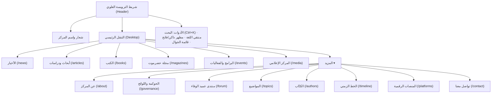

# 04. معمارية المعلومات وهندسة التنقل والقوائم
## Information Architecture, Navigation Hierarchy & Route Placement

> **الهدف الهندسي:** التوفيق الدقيق بين مقترح تقرير المركز الموسع وبين الحفاظ الصارم على التصميم الحالي للموقع دون ازدحام أو تشويه لتجربة المستخدم.  
> **مبدأ الحفاظ على التصميم:** لا يُسمح بإعادة تصميم الواجهة العامة، بل المحافظة الكاملة على شريط التنقل (`PriorityNav`)، خطوط الطباعة، نمط الترويسة والتذييل، والرموز البصرية (`Tokens`).

---

## 1. التوفيق بين مقترح المركز وهندسة الموقع الحالية

اقترح تقرير المركز قائمة علوية تتضمن 9 أقسام رئيسية وعشرات التفريعات الفرعية. من منظور هندسي وتجربة مستخدم (UX)، وضع 9 عناصر عريضة في شريط التنقل العلوي باللغة العربية سيؤدي حتماً إلى:
1. انكسار السطر وتداخل العناصر على الشاشات المتوسطة (Tablets & Small Laptops 1024px–1280px).
2. تشويش الباحث والزائر العادي بكم هائل من الروابط قبل الوصول للمحتوى المعرفي (المقالات والكتب والمجلات).

لذلك نضع أمام إدارة المشروع **خيارين معماريين مدروسين**:
- **الخيار الأول (الموصى به - Recommended Architecture):** شريط تنقل ذكي يعتمد على الأقسام المعرفية الكبرى، مع تجميع الصفحات المؤسسية في قوائم منسدلة أنيقة ومتجاوبة، وتوزيع باقي الروابط في التذييل وصفحات الفهارس.
- **الخيار الثاني (البديل المباشر - Direct Category Mapping):** شريط تنقل من 6 محاور عليا فقط تندرج تحتها جميع مطالب تقرير المركز دون أي ازدحام.

---

## 2. الخيار الأول (الموصى به): شريط التنقل المتوازن

يحافظ هذا الخيار على توزيع المنصة الحالي المتقن، مع استيعاب الإضافات الجديدة بسلاسة:



### تفصيل عناصر القائمة العلوية والأقسام الفرعية:
1. **الأخبار (`/ar/news`):** التغطيات الصحفية لأنشطة المركز.
2. **أبحاث ودراسات (`/ar/articles`):**
   - الدراسات التاريخية والاجتماعية والثقافية.
   - المقالات والبحوث المنشورة.
   - رابط سياقي لمعايير وأخلاقيات النشر الأكاديمي (`/ar/research/guidelines`).
3. **الكتب (`/ar/books`):** إصدارات المركز، المطبوعات، وتحقيقات التراث مع فلاتر البحث وإمكانية تنزيل الـ PDF المتاح.
4. **مجلة حضرموت (`/ar/magazines`):** أعداد مجلة «حضرموت الثقافية» الدورية وفهارس الأعداد وروابط القراءة.
5. **البرامج والفعاليات (`/ar/events`):**
   - المؤتمرات والندوات العلمية.
   - المحاضرات وورش العمل واللقاءات الافتراضية.
   - فعاليات «منتدى عميد الوفاء» (كقسم فرعي أو تبويب تصفية).
   - مسابقات المركز وبرامج الدعم.
6. **المركز الإعلامي (`/ar/media`):**
   - المرئيات والندوات المصورة.
   - المكتبة السمعية وبودكاست سقاية.
   - إعلانات المركز والبيانات الرسمية.
   - شركاء النجاح و«قالوا عنا».
7. **عن المركز (`/ar/about` - متاح في «المزيد» وبداية الفوتر):**
   - كلمة رئيس المركز.
   - السياق الوطني والعلمي والهوية المؤسسية (الرؤية والرسالة والقيم).
   - الهيكل التنظيمي، مجلس الإدارة، فريق العمل والمستشارون.
   - الحوكمة واللوائح والتقارير السنوية (`/ar/governance`).

---

## 3. الخيار الثاني (البديل المدمج - Consolidated Alternative)

إذا رغب المركز في تقليص القائمة العلوية إلى أقصى حد ممكن لتركيز الانتباه:
1. **الرئيسية (`/ar`)**
2. **عن المركز والحوكمة (`/ar/about`):** يشمل الهوية، القيادة، اللوائح، والتقارير.
3. **المعرفة والإنتاج العلمي (`/ar/knowledge`):** يجمع الدراسات، الكتب، ومجلة حضرموت.
4. **البرامج والأنشطة (`/ar/programs`):** المؤتمرات، الندوات، منتدى عميد الوفاء، والبودكاست.
5. **المركز الإعلامي (`/ar/media`):** الأخبار، المرئيات، السمعيات، والإعلانات.
6. **تواصل معنا (`/ar/contact`)**

---

## 4. معمارية التذييل المطور (Footer Architecture)

يحافظ التذييل على تقسيمه الرباعي الرصين، مع إضافة الروابط المؤسسية الجديدة وتصحيح رابط الشريك التقني:

```
+---------------------------------------------------------------------------------------------------------+
| [ النشرة البريدية ]  اشترك في النشرة الإخبارية الدورية لمركز حضرموت      [ حقل البريد ] [ زر الاشتراك ] |
+---------------------------------------------------------------------------------------------------------+
| [ نبذة المركز وشبكات التواصل ] | [ أبحاث وإصدارات ] | [ أدوات الباحث ]     | [ عن المركز والحوكمة ]   |
|                                | - المقالات والدراسات | - محرك البحث المتقدم | - كلمة رئيس المركز       |
| مركز حضرموت للدراسات التاريخية  | - إصدارات الكتب     | - دليل الكتّاب       | - الهيكل التنظيمي والإدارة|
| والتوثيق والنشر...             | - مجلة حضرموت       | - الخط الزمني الحضرمي| - اللوائح والسياسات     |
| [X] [FB] [IG] [TG] [YT] [WA]   | - المؤتمرات والندوات | - فهرس المواضيع      | - التقارير السنوية      |
| المكلا، حي الشهيد خالد        | - المركز الإعلامي   | - المحفوظات (Offline)| - شركاء النجاح          |
| info@hadramout.center          | - بودكاست سقاية     | - خلاصات RSS         | - تواصل معنا            |
+---------------------------------------------------------------------------------------------------------+
| حقوق النشر © 2026 مركز حضرموت للدراسات التاريخية والتوثيق والنشر — كافة الحقوق محفوظة                    |
| الشريك التقني: [نوفكسا (Novixa)](/ar/novixa) · [شروط الاستخدام](/ar/terms) · [الخصوصية](/ar/privacy)     |
+---------------------------------------------------------------------------------------------------------+
```

### معالجة رابط الشريك التقني في الفوتر:
- **الوضع الحالي:** رابط مباشر إلى `https://novixa.dev` في سطر الحقوق السفلي.
- **التعديل المعتمد المقترح:**  
  تعديل كود [`src/components/Shell.tsx:177`](file:///d:/novixa-work/hadramout-center-platform/src/components/Shell.tsx#L177) ليصبح الرابط داخلياً يشير إلى صفحة الشريك التقني الرسمية في المنصة:
  ```tsx
  <span>{t('footer.techPartner')}: <Link href={href('/novixa')}>نوفكسا (Novixa)</Link></span>
  ```
  هذا يحقق الإشادة المهنية بالسياق المؤسسي المحلي دون إخراج الزائر من الموقع.

---

## 5. قواعد موضع الصفحة في القوائم من لوحة التحكم (Navigation Placement Rules)

لحماية القائمة الرئيسية من العشوائية وضمان عدم امتلاء القوائم بصفحات فرعية دون تخطيط، يتم تطبيق القواعد التالية داخل حقول مجموعة `Pages`:

1. **الوضع الافتراضي الإلزامي:** `not_in_navigation` (غير مدرجة في أي قائمة).
2. **خيارات موضع الصفحة (`navPlacement`):**
   - `none`: صفحة مستقلة (Landing Page) لا تظهر في أي قائمة تلقائية ولكن يمكن مشاركة رابطها أو فهرستها.
   - `primary`: في القائمة العلوية الرئيسية (يتطلب دور Admin وحقل ترتيب `order`).
   - `secondary_dropdown`: داخل قائمة «المزيد» المنسدلة في الترويسة.
   - `footer_about`: في تذييل الموقع ضمن عمود «عن المركز والحوكمة».
   - `footer_explore`: في تذييل الموقع ضمن عمود «أبحاث وإصدارات».
   - `footer_legal`: في سطر الروابط القانونية أسفل الفوتر.
3. **تنبيه الصفحات اليتيمة (Orphan Pages Warning):**  
   يوفر النظام فحصاً في لوحة التحكم ينبه المحرر إذا كانت الصفحة المنشورة غير مرتبطة بأي قائمة أو رابط داخلي، لتجنب الصفحات المنعزلة عن الزوار ومحركات البحث.

---

## 6. مسارات الصفحات العامة الجديدة وحالتها (Route Placement Map)

| المسار المقترح | طبيعة المحتوى والهدف | نوع الصفحة | موضع التنقل | حالة الاعتماد |
|---|---|---|---|---|
| `/ar/about` | النبذة المؤسسية الرئيسية، الرؤية والرسالة والأهداف. | CMS Page | القائمة العلوية (المزيد) + الفوتر | بانتظار اعتماد نصوص المركز |
| `/ar/about/word` | كلمة رئيس المركز (مقال تأصيلي لرئيس مجلس الإدارة). | CMS Page | قائمة عن المركز + الفوتر | بانتظار النص من المركز |
| `/ar/about/leadership` | الهيكل التنظيمي، مجلس الإدارة، فريق العمل، واللجان. | CMS Page (كتل هيكلية) | قائمة عن المركز | بانتظار الأسماء والمناصب |
| `/ar/governance` | اللوائح، السياسات المؤسسية، والتقارير السنوية (PDFs). | CMS Page + كتل تنزيل | قائمة عن المركز + الفوتر | بانتظار ملفات اللائحة |
| `/ar/research/guidelines` | معايير النشر في المجلة والدراسات وأخلاقيات التحكيم. | CMS Page | سياقي داخل صفحة المقالات | بانتظار سياسة النشر |
| `/ar/media` | بوابة المركز الإعلامي الجامعة للمرئيات والسمعيات والإعلانات. | Listing Route مخصص | القائمة العلوية الرئيسية | جاهزة للتنفيذ في المرحلة 5 |
| `/ar/media/audio` | المكتبة السمعية وحلقات البودكاست المسجلة. | Listing Route جديد | قائمة المركز الإعلامي | بانتظار تزويد ملفات الصوت |
| `/ar/media/announcements` | إعلانات المركز والفعاليات القادمة (مع إمكانية حفظ `.ics`). | Listing Route جديد | قائمة المركز الإعلامي | جاهزة للتنفيذ في المرحلة 5 |
| `/ar/platforms` | دليل المنصات والمبادرات الرقمية للمركز. | CMS Page (شبكة بطاقات) | القائمة العلوية (المزيد) | تقتصر على المنصات النشطة فقط |
| `/ar/novixa` | صفحة تعريفية بالشريك التقني ومواصفات المنصة. | CMS Page قائمة حالياً | رابط «الشريك التقني» في الفوتر | موجودة وتعمل بنجاح |

---

## 7. تجربة قائمة الجوال ولوحة المفاتيح (Mobile Menu & Accessibility)

- **قائمة الجوال (`MobileMenu.tsx`):**
  - تفتح عبر زر برغر متوافق مع معايير الوصول (`aria-label`, `aria-expanded`).
  - مصممة كدرج انزلاقي جانبي من اليمين (RTL) يتضمن: الرئيسية، الأقسام المعرفية الكبرى، قائمة قابلة للطي للأقسام المؤسسية، المحفوظات، ومبدل المظهر (داكن/فاتح).
  - حظر التمرير الخلفي للشاشة أثناء فتح القائمة (`overflow: hidden`).
- **التنقل عبر لوحة المفاتيح (Keyboard Navigation):**
  - دعم زر تخطي التنقل (`Skip to content`) للانتقال المباشر للمحتوى الرئيسي.
  - إمكانية فتح القوائم المنسدلة والتنقل بين عناصرها عبر مفاتيح `Tab`, `Enter`, `Escape`, ومفاتيح الأسهم.
  - حلقة تركيز بصرية واضحة (`focus-visible`) متوافقة مع معيار التباين العالي.
