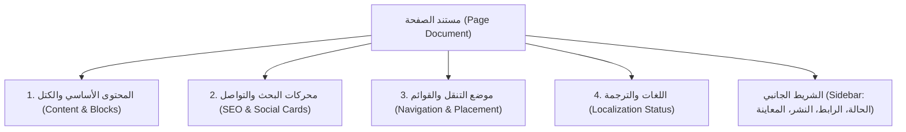

# 05. معمارية لوحة التحكم ومنشئ الصفحات المطور
## Payload CMS Dashboard Architecture, Structured Page Builder & Live Preview

> **الهدف الفني:** ترقية تجربة إدارة المحتوى في Payload 3 من مجرد محرر نصوص بسيط (`textarea`) إلى **منشئ صفحات هيكلي متقدم (Modular Page Builder)** يمنح المحررين مرونة بصرية كاملة مع الحفاظ الصارم على هوية التصميم وأمان الشيفرة.  
> **التوافق:** مبني بالكامل على ميزات Payload 3.92 الأصلية (Blocks field, Tabs, Live Preview, Drafts).

---

## 1. تقييم الوضع الحالي ومبررات الترقية

في الكود الحالي [`src/collections/Pages.ts`](file:///d:/novixa-work/hadramout-center-platform/src/collections/Pages.ts):
- تحتوي مجموعة الصفحات على: `title`, `slug`, `body`, `status`, `translationMeta`.
- حقل `body` هو حقل نصي واحد يعتمد على محرر HTML، مما يعرض التنسيق للتخريب غير المقصود من المحررين، ويجعل إنشاء صفحات معقدة (مثل الهيكل التنظيمي، تقارير الحوكمة، أو معرض المبادرات) مستحيلاً دون الاستعانة بمطور يكتب كود HTML.
- غياب كامل لحقول الـ SEO المنفصلة، خيارات موضع التنقل، والمعاينة الحية قبل النشر.

---

## 2. الهيكل الجديد لمجموعة الصفحات (Pages Collection Schema)

يتم تنظيم شاشة تحرير الصفحة عبر تبويبات منطقية (`Tabs`) تمنع التشتت وتوفر تجربة تحرير مريحة:

### 2.1 حقول الشريط الجانبي (Sidebar Fields)
- **المعرّف في الرابط (`slug`):** نصي فريد مع فحص فوري للتكرار والرموز غير الصالحة.
- **حالة النشر (`status`):** مسودة (`draft`)، منشور (`published`)، مؤرشف (`archived`).
- **تاريخ النشر والجدولة (`publishedAt`):** تاريخ ووقت النشر الفعلي أو المجدول مستقبلاً.
- **زر المعاينة الحية (`Live Preview Button`):** يفتح نافذة منقسمة لمعاينة المسودة مباشرة على تصميم الموقع الحقيقي.

---

## 3. كتالوج الكتل البنائية القابلة لإعادة الاستخدام (Reusable Page Blocks)

تتألف الصفحة من حقل `blocks` مخصص يتيح للمحرر إضافة، ترتيب، إخفاء، وتكرار الكتل التالية بكل أمان:

| رمز الكتلة | اسم الكتلة | الحقول التحريرية المتاحة | المكون البرمجي المقابل (Frontend Component) | ضوابط الأمان وإمكانية الوصول (A11y) |
|---|---|---|---|---|
| `hero` | **ترويسة الصفحة (Hero Section)** | سطر تمهيدي (Eyebrow)، العنوان الرئيسي (H1)، نص موجز، صورة خلفية أو غلاف اختياري، وزر إجراء (CTA). | `HeroBlock.tsx` | تباين ألوان متوافق مع AA، وتحديد حجم الصورة تلقائياً لمنع وميض الشاشة (CLS). |
| `richText` | **النص الغني المتكامل** | محرر Lexical/Tiptap يدعم العناوين الهيكلية (H2, H3)، القوائم النقطية والرقمية، الروابط، والجداول. | `RichTextBlock.tsx` | تنقية HTML تلقائياً (`sanitizeHtml`)، ومنع أي كود JavaScript أو أنماط CSS خارجية خبيثة. |
| `sectionHeading` | **عنوان وقاطع قسم** | عنوان القسم، عنوان فرعي توضيحي، ومحاذاة (يمين/وسط). | `HeadingBlock.tsx` | استخدام وسوم العناوين الدلالية (`h2`/`h3`) فقط لتغذية شجرة قراءة الشاشة. |
| `textWithImage` | **نص وصورة متوازيان** | عنوان، نص فقرة، صورة توضيحية من الوسائط، نص بديل إلزامي، واتجاه الصورة (يمين أو يسار النص). | `TextWithImageBlock.tsx` | حقل النص البديل (`alt`) إلزامي لمنع الصور الصامتة في قارئات الشاشة. |
| `cardGrid` | **شبكة بطاقات معرفية** | نوع الشبكة (يدوية: عناوين وصور وروابط / ديناميكية: جلب أحدث الكتب أو المقالات أو الأخبار)، عدد الأعمدة (2، 3، 4). | `CardGridBlock.tsx` | روابط كاملة قابلة للتنقل بلوحة المفاتيح وبطاقات متجاوبة مع الهاتف. |
| `quoteCallout` | **مقتبس أو تنبيه مميز** | نص المقتبس، اسم القائل، المصدر أو المناسبة، نمط الصندوق (اقتباس تراثي، معلومة مهمة، تنبيه). | `QuoteBlock.tsx` | وسم `<blockquote>` الدلالي مع شريط لوني مشتق من هوية المركز. |
| `mediaEmbed` | **تضمين مرئي أو صوتي** | رابط يوتيوب، أو ملف صوتي محلي (MP3)، عنوان المادة، ونبذة نصية أو تفريغ مكتوب اختياري. | `MediaEmbedBlock.tsx` | استخدام واجهة `VideoFacade` لحماية خصوصية الزوار، وعدم تحميل مكتبات يوتيوب إلا عند النقر. |
| `fileDownload` | **بطاقة تنزيل ملفات (PDF)** | عنوان الملف، الوصف، علاقة بملف الوسائط المحلي أو رابط خارجي معتمد، وحجم الملف التقديري. | `DownloadBlock.tsx` | أيقونة نوع الملف، وتحذير واضح بحجم الملف عند كبر حجمه للزوار عبر الهواتف. |
| `statsStrip` | **شريط أرقام وإحصائيات** | مصفوفة عناصر: رقم إحصائي (مثال: 700 ألف)، تسمية توضيحية (وثيقة)، وأيقونة دلالية. | `StatsBlock.tsx` | نصوص واضحة بدلاً من أرقام مجردة لضمان قراءتها بشكل صحيح في قارئات الشاشة. |
| `accordionFaq` | **قوائم قابلة للطي (Accordion)** | مصفوفة أسئلة وأجوبة أو بنود لوائح وسياسات مؤسسية (عنوان البند، وتفاصيله). | `AccordionBlock.tsx` | استخدام وسوم `
` و`
` الدلالية الأصلية بدون جافاسكريبت ثقيل. |
| `ctaBox` | **صندوق دعوة لاتخاذ إجراء** | عنوان بارز، نص تحفيزي، نص الزر، ورابط الوجهة (داخلي أو خارجي). | `CtaBlock.tsx` | تباين ألوان مرتفع وزر تفاعلي واضح. |

---

## 4. تبويب محركات البحث ومشاركات التواصل (SEO & Social Tab)

يمنح هذا التبويب المحرر تحكماً كاملاً بالظهور في محركات البحث ومواقع التواصل:
- **عنوان محركات البحث (`metaTitle`):** عنوان مخصص يظهر في شريط المتصفح وجوجل، مع عداد أحرف مرئي (يوصى بـ 50–60 حرفاً).
- **الوصف التعريفي (`metaDescription`):** ملخص دقيق يظهر في نتائج البحث (يوصى بـ 120–155 حرفاً).
- **صورة المشاركة الاجتماعية (`ogImage`):** إمكانية رفع صورة مخصصة بنسبة 1200×630، مع استخدام الغلاف التلقائي عند عدم التحديد.
- **توجيهات الفهرسة (`robots`):**
  - الفهرسة الافتراضية: مفهرس ومتابع (`index, follow`).
  - خيار حجب الفهرسة (`noindex`): للصفحات الخاصة أو الداخلية.
- **الرابط القياسي (`canonicalUrl`):** اختياري، يُولد تلقائياً لمنع تكرار المحتوى.
- **معاينة بطاقة التواصل (Social Preview Widget):** مكون تفاعلي داخل اللوحة يعرض للمحرر مباشرة كيف ستظهر الصفحة على واتساب وفيسبوك وتويتر قبل النشر.

---

## 5. تبويب موضع التنقل في القوائم (Navigation Placement Tab)

يمنع العشوائية ويجعل هيكل الموقع متماسكاً:
- **موضع الصفحة (`placement`):**
  - `none`: غير مدرجة في القوائم (الوضع الافتراضي الآمن).
  - `primary`: في القائمة العلوية الرئيسية.
  - `dropdown`: داخل قائمة «المزيد» المنسدلة في الترويسة.
  - `footer_about`: في الفوتر ضمن عمود «عن المركز والحوكمة».
  - `footer_explore`: في الفوتر ضمن عمود «أبحاث وإصدارات».
- **الترتيب النسبي (`navOrder`):** رقم ترتيبي لتحديد أسبقية الظهور بين الروابط الشقيقة.
- **تسمية الرابط المختصرة (`navLabel`):** نص قصير مخصص للقائمة في حال كان عنوان الصفحة طويلاً.

---

## 6. نظام المعاينة الحية الفورية للمسودات (In-Dashboard Live Preview)

يتم تفعيل ميزة `Live Preview` المدمجة في Payload 3 عبر التكامل مع Next.js:

1. **نقطة نهاية المعاينة الآمنة (`/api/preview`):**
   - توليد رمز توثيق زمني مؤقت (`signed preview token`).
   - التحقق من صلاحية المستخدم (يقتصر على الموظفين المسجلين).
   - إرسال رأس `x-robots-tag: noindex, nofollow` الصارم لمنع محركات البحث من رؤية المسودات.
2. **شاشة المعاينة التفاعلية داخل لوحة التحكم:**
   - تقسيم الشاشة: حقول التحرير في الجانب الأيمن، ومعاينة حية للموقع الحقيقي في الجانب الأيسر.
   - أزرار تبديل قياس الشاشة: هاتف محمول (390px)، جهاز لوحي (768px)، وشاشة حاسوب (1440px).
   - زر تبديل اللغة الحية لمعاينة النسخة العربية والإنجليزية وتأكيد صحة الاتجاه (RTL/LTR).
3. **قائمة فحص ما قبل النشر (Pre-Publish Checklist):**
   قبل تحويل المسودة إلى «منشور»، يُظهر النظام فحصاً تلقائياً ينبه المحرر إلى:
   - هل حقول الـ SEO مكتملة أم تعتمد على النص التلقائي؟
   - هل توجد صور تفتقر للنص البديل الوصفي؟
   - هل تم تحديد موضع مناسب للصفحة في القوائم؟
   - هل الترجمة الإنجليزية متوفرة أم مسودة بحاجة لمراجعة؟
