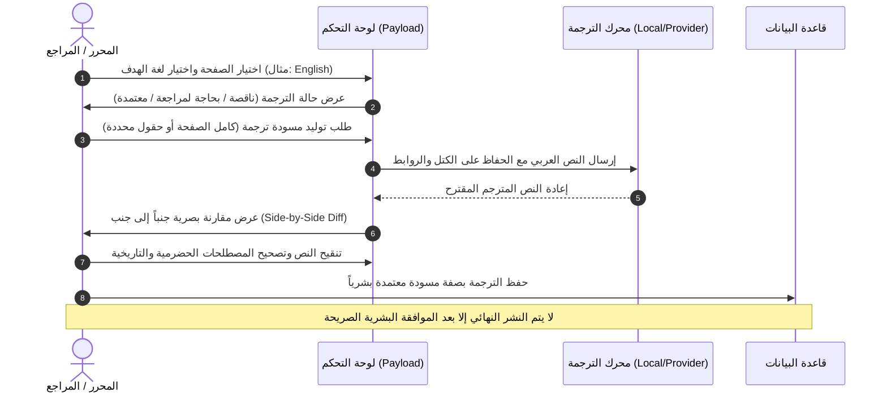

# 06. التعريب والترجمة وأدوات المساعد التحريري
## Multilingual Architecture, Human-in-the-Loop Translation & Editorial Tools

> **المنهجية المعتمدة:** العربية أولاً (`Arabic-first`) بصفتها لغة الإنتاج العلمي والتوثيق للمركز، مع إتاحة المحتوى بلغات عالمية عبر نظام ترجمة هجين محكم يضع المحرر والمراجع البشري حارساً إلزامياً قبل النشر.  
> **مبدأ التكلفة والخصوصية:** الاعتماد المطلق على الأدوات مفتوحة المصدر وقابلة الاستضافة الذاتية (Self-hostable)، ومنع إرسال أي أبحاث أو مسودات غير منشورة إلى خوادم سحابية خارجية دون موافقة صريحة.

---

## 1. المعمارية الحالية للغات والترجمة (Current Locale Stack)

وفق ملفات النظام المعتمدة [`src/i18n/locales.ts`](file:///d:/novixa-work/hadramout-center-platform/src/i18n/locales.ts) و[`src/i18n/languages.ts`](file:///d:/novixa-work/hadramout-center-platform/src/i18n/languages.ts):
- **اللغة الافتراضية:** العربية (`ar`)، باتجاه من اليمين إلى اليسار (`RTL`).
- **اللغات النشطة في الواجهة ومحرك الترجمة:** 98 لغة عالمية، مع تمييز اللغات الأكثر طلباً (الإنجليزية، الفرنسية، الملايوية، الإندونيسية، الصينية، التركية، الألمانية، الإسبانية، والروسية).
- **نموذج تخزين البيانات:** جداول منفصلة للترجمات لكل مجموعة (`*_locales` في SQLite)، مما يضمن عدم تضخم الجدول الرئيسي وسهولة إضافة لغات دون تعديل هيكل قاعدة البيانات.
- **شريط تنبيه الترجمة (`TrBanner.tsx`):** يعرض بوضوح للقارئ في اللغات غير العربية ما إذا كانت الترجمة آلية قيد المراجعة أو معتمدة بشرياً، مع زر للتبليغ عن خطأ تحريري.

---

## 2. سير عمل الترجمة التحريري المقترح (Editorial Translation Workflow)

يتم تطوير واجهة الترجمة داخل لوحة التحكم لتمكين المحرر والمراجع من الخطوات التالية:

### 2.1 القواعد الصارمة لإدارة المحتوى المترجم
1. **الأصل العربي مصون تماماً:** لا يجوز لأي عملية ترجمة الكتابة فوق الحقول العربية أو تعديلها.
2. **المقارنة البصرية المسبقة (Side-by-Side Diff):** إظهار النص الأصلي بجانب الترجمة المقترحة مع تظليل الفروقات قبل التطبيق.
3. **الحفاظ على البنية الهيكلية:** صيانة الروابط التشعبية، المراجع، ترتيب الكتل البنائية، الصور، الأرقام والتواريخ، والوسوم الدلالية أثناء الترجمة.
4. **اكتشاف الترجمات المتقادمة (Stale Translations):** عند تعديل المقال العربي الأصلي بعد ترجمته، يضع النظام علامة تنبيه صفراء في اللوحة تفيد بأن «الترجمة الإنجليزية بحاجة للتحديث لمطابقة التعديل العربي الجديد»، دون حذف الترجمة القائمة تلقائياً.
5. **دور مراجع الترجمة (`Reviewer Role`):** صلاحيات المراجع محصورة فقط في تعديل الحقول المترجمة خارج اللغة العربية، ولا يملك صلاحية نشر المقال الأصلي أو تغيير حالته.

---

## 3. تقييم أدوات المساعد التحريري والترجمة الذاتية (Tools Evaluation Matrix)

| الأداة البرمجية | الغرض والاستخدام | نوع الترخيص | حالة الاستضافة الذاتية | جودة ودعم اللغة العربية | المتطلبات التشغيلية | الخصوصية والأمان | التوصية الهندسية |
|---|---|---|---|---|---|---|---|
| **Argos Translate** | محرك ترجمة نصوص آلي بدون اتصال. | مفتوح المصدر (MIT) | نعم، بالكامل على الخادم محلياً. | متوسطة؛ مناسبة للمسودات الأولية بين العربية والإنجليزية، ولكنها تتطلب مراجعة بشرية للمصطلحات التراثية. | بايثون 3، معالجة معتدلة (يحتاج ~1.5GB RAM للنموذج). | خصوصية 100%؛ لا يخرج أي حرف خارج الخادم. | **يوصى به كخيار محلي اختياري** للمسودات الأولية خلف بوابة مراجعة بشرية. |
| **LanguageTool Community** | تدقيق إملائي ونحوي وتنسيقي. | مفتوح المصدر (LGPL 2.1) | نعم، يمكن تشغيله كحاوية Docker ذاتية. | جيدة جداً في الإملاء والتشكيل العربي وعلامات الترقيم وتصحيح همزات الوصل والقطع. | يحتاج بيئة Java، واستهلاك ذاكرة بين 1GB إلى 2GB RAM. | خصوصية تامة على الخادم الداخلي. | **يوصى به بشدة** كمدقق لغوي مساعد للمحرر في لوحة التحكم. |
| **cspell** | تدقيق إملائي للمصطلحات الإنجليزية وتسميات البرمجة. | مفتوح المصدر (MIT) | نعم، أداة Node.js خفيفة جداً. | يقتصر على اللغات اللاتينية (الإنجليزية). | شبه معدومة (أقل من 50MB RAM). | محلية تماماً. | **موصى به** لتدقيق النصوص الإنجليزية ومسارات الروابط (`slugs`). |
| **واجهات السحاب الخارجية (Anthropic / OpenAI / Google)** | اقتراح ملخصات وعناوين وترجمة متقدمة. | خدمات تجارية مغلقة | لا، سحابية تتطلب مفاتيح واشتراك. | فائقة الجودة في الصياغة الأكاديمية واللغوية المعقدة. | تتطلب رصيد API واتصالاً خارجياً. | ترسل مسودات النصوص لخوادم خارجية، مما يتطلب موافقة المركز. | **اختياري وغير إلزامي**؛ يبقى معطلاً افتراضياً، ويعمل فقط إن وفّر المركز مفتاحه الخاص. |

---

## 4. وظائف المساعد التحريري المقترح داخل لوحة التحكم

عند تفعيل أدوات المساعدة، تقدم للمحرر دعماً غير تدخلي (Non-intrusive) عبر زر استشاري:

1. **التدقيق اللغوي والإملائي العربي:**
   - فحص همزات الوصل والقطع (إبراهيم، إنشاء، ابن).
   - توحيد الياء والألف المقصورة (علي / على) وضبط التاء المربوطة والهاء (حضرموت، به).
   - إزالة الفراغات الزائدة قبل علامات الترقيم (الفواصل والنقاط).
2. **مقترحات محركات البحث ومقتطفات التواصل:**
   - اقتراح ملخص (Excerpt) مكثف لا يتجاوز 150 حرفاً مشتق من مقدمة البحث.
   - اقتراح عنوان محركات بحث جذاب ومنضبط في حدود 60 حرفاً.
3. **توليد النص البديل الوصفي للصور (`alt text`):**
   - اقتراح نص وصفي مستمد من سياق المقال (مثال: «صورة وثيقة تاريخية لمعاهدة صلح إنجرامس بحضرموت عام 1937»).
4. **تنبيهات التناسق التحريري:**
   - تنبيه المحرر عند وجود تواريخ هجرية وميلادية متباينة أو غير متطابقة.
   - تنبيه المحرر عند تكرار عنوان المقال مع مقال منشور سابقاً.

---

## 5. ضوابط الأمان والنزاهة الأكاديمية (Integrity Guardrails)

- **منع النشر التلقائي للذكاء الاصطناعي:** يُحظر تماماً في النظام برمجة أي ميزة تنشر نصوصاً تم توليدها بالذكاء الاصطناعي بشكل آلي دون اعتماد صريح من المحرر البشري.
- **منع اختراع المراجع والاستشهادات (No Hallucination):** المساعد التحريري ممنوع برمجياً من اقتراح مراجع أو أرقام صفحات أو أحداث تاريخية لم ترد في نص المقال الأصلي.
- **سجل التدقيق (Audit Logging):** تسجيل اسم المستخدم والوقت لكل عملية ترجمة أو تعديل لضمان المسؤولية التحريرية الكاملة.
