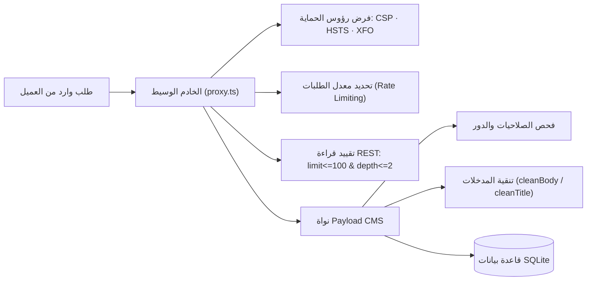

# 09. الأمن السيبراني، الخصوصية، واستراتيجية ترحيل البيانات
## Security Posture, Role-Based Access Control, Privacy & Data Migration Protocols

> **الهدف الهندسي:** تحصين المنصة وبيانات المركز التاريخية والأكاديمية ضد الاختراق أو التسريب، وإرساء ضوابط أمان تمنع أي تغيير غير مصرح به، مع وضع خطة ترحيل آمنة قابلة للتراجع الكامل (Zero Data Loss).  
> **حالة التدقيق الأمني:** تم إغلاق 16 بنداً أمنياً سابقاً (SEC-001 إلى SEC-016)، مع استمرار التحصين المستمر في هذا التحديث.

---

## 1. نموذج الصلاحيات وإدارة الأدوار (Role-Based Access Control - RBAC)

يعتمد النظام ثلاثة أدوار تحريرية محكمة مبنية على مبدأ الصلاحيات الأدنى (Principle of Least Privilege):

| الدور التحريري | الصلاحيات المصرح بها | القيود الصارمة والمحظورات | آلية الإنفاذ البرمجية |
|---|---|---|---|
| **مدير النظام (`admin`)** | - إدارة المستخدمين والأدوار.<br>- تعديل إعدادات الموقع العامة (`Site`).<br>- نشر وحذف وأرشفة أي مادة.<br>- تشغيل وإدارة مهام النظام. | - حظر مشاركة الحساب بين عدة موظفين.<br>- إلزامه بكلمة مرور قوية ومسار تحقق ثنائي. | `isAdmin` في [`src/collections/shared.ts:16`](file:///d:/novixa-work/hadramout-center-platform/src/collections/shared.ts#L16). |
| **المحرر (`editor`)** | - إنشاء وتعديل كافة المواد المعرفية والصفحات.<br>- رفع الصور وملفات الـ PDF المصرح بها.<br>- تعديل حسابه الشخصي فقط. | - **ممنوع تماماً من حذف أي مادة** (الحذف محصور بمدير النظام لمنع فقدان الأرشيف خطأً).<br>- ممنوع من إنشاء مستخدمين أو ترقية دوره.<br>- ممنوع من تغيير إعدادات الموقع العامة. | `isEditorOrAdmin` في [`shared.ts:17`](file:///d:/novixa-work/hadramout-center-platform/src/collections/shared.ts#L17). |
| **مراجع الترجمة (`reviewer`)** | - تنقيح ومراجعة الحقول النصية المترجمة باللغات الأجنبية (الإنجليزية، الفرنسية...). | - **ممنوع منعاً باتاً من لمس أو تعديل الأصل العربي** لأي مقال أو كتاب.<br>- الحقول العربية تظهر له للقراءة فقط (`read-only`).<br>- ممنوع من النشر أو تغيير حالة المادة أو تعديل التواريخ أو التصنيفات. | دالة `lockForReviewers` وحقل `localizedUpdate` في [`shared.ts:23-42`](file:///d:/novixa-work/hadramout-center-platform/src/collections/shared.ts#L23-L42). |

---

## 2. مصفوفة الضوابط الأمنية وحماية الهجمات (Security Safeguards)



### 2.1 ضوابط الأمان الفعالة ومواقع إنفاذها:
1. **منع هجمات التضمين وخداع النقر (Clickjacking Protection - SEC-011):**
   - إنفاذ رأسي `X-Frame-Options: SAMEORIGIN` و`frame-ancestors 'self'` على كافة مسارات `/admin` و`/api`.
   - لا يمكن لأي موقع خارجي تضمين لوحة التحكم في إطار `<iframe>` لخداع موظفي المركز.
2. **أمان رفع الملفات وحظر هجمات XSS (Upload Safety - SEC-013):**
   - حصر أنواع الملفات المرفوعة في قائمة بيضاء صارمة: `image/jpeg`, `image/png`, `image/webp`, `image/avif`, `image/gif`, `application/pdf`.
   - **حظر تام لرفع ملفات SVG:** لأن ملفات SVG تقبل تضمين أكواد JavaScript خبيثة تُنفذ في متصفح مدير النظام عند استعراضها.
   - فرض رأس `Content-Security-Policy: script-src 'none'` على مجلد الملفات المرفوعة.
3. **أمان استعادة كلمة المرور وإرسال البريد (SEC-012):**
   - تعطيل طلبات `/forgot-password` وإرجاع خطأ `403 Forbidden` صريح حتى يتم ضبط مزود بريد معتمد (`MAIL_PROVIDER`)، لمنع تسجيل طلبات وهمية في السجلات وخداع الموظفين.
4. **حظر هجمات القوة الغاشمة (Brute Force):**
   - قفل الحساب تلقائياً لمدة 15 دقيقة بعد 5 محاولات دخول خاطئة متتالية (`maxLoginAttempts: 5`, `lockTime: 15 * 60 * 1000`).
   - ملفات تعريف ارتباط الجلسة (Session Cookies) موسومة بـ `HttpOnly; Secure; SameSite=Lax` ومدتها 12 ساعة فقط.
5. **تقييد واجهة برمجة التطبيقات (REST & GraphQL Security):**
   - إلغاء تفعيل واجهة GraphQL تماماً (`graphQL: { disable: true }`) لسد باب استعلامات الاستنزاف العميقة.
   - تقييد استعلامات REST العامة بحد أقصى `limit <= 100` وعمق `depth <= 2`.

---

## 3. بوابة المساهمات العلمية واستقبال الملفات (Submission Workflows)

عند بناء بوابة استقبال أبحاث المجلة ومساهمات الباحثين (المرحلة 6)، تطبق الضوابط التالية:
1. **التحقق الصارم من امتدادات وحجم الملفات:** قبول ملفات `PDF` و`DOCX` فقط، بحد أقصى **15 ميجابايت** للملف الواحد.
2. **عزل التخزين (Storage Isolation):** تخزين الملفات المرفوعة في مجلد داخلي معزول خارج مسار الويب العام، ولا يمكن الوصول إليها إلا عبر مصادقة الموظف المختص.
3. **سير العمل التحريري المنضبط:** أي بحث يتم تقديمه يدخل في حالة مسودة قيد التدقيق (`submission_status: pending_review`)، ويُحظر برمجياً نشره تلقائياً على الموقع العام.
4. **حماية الخصوصية:** حجب بيانات الباحثين (أرقام الهواتف والبريد الإلكتروني ومسودات أبحاثهم) عن أي استجابات عامة للواجهة البرمجية.

---

## 4. بروتوكول ترحيل وتحديث البيانات والتراجع الآمن (Migration & Rollback Protocol)

تلتزم أي ترقية لهيكل قاعدة البيانات بالمعايير الهندسية الصارمة التالية لضمان عدم فقدان أي حرف من أرشيف المركز:

### 4.1 خطوات ما قبل الترحيل (Pre-Migration Checklist)
1. **النسخ الاحتياطي الإلزامي المزدوج:**
   - أخذ نسخة فورية كاملة من قاعدة البيانات `data/payload.db`.
   - أخذ نسخة كاملة من مجلد الوسائط والصور المرفوعة `public/legacy-media/` ومجلد الوسائط المحلي.
   - التحقق من سلامة الأرشيف عبر فحص الحجم والتأكد أن أمر `tar` انتهى بنجاح (فشل النسخ يوقف عملية الترحيل فوراً).
2. **محاكاة الترحيل في بيئة معزولة (Dry-Run):**
   - اختبار تشغيل كود الترحيل على نسخة محلية متطابقة مع التحقق من رجعية الترحيل (اختبار دالتي `up` و`down`).

### 4.2 استراتيجية التراجع الفوري (Rollback Strategy)
في حال حدوث أي خطأ أو فشل غير متوقع أثناء تطبيق التعديل:
```bash
# 1. إيقاف الخادم فوراً
docker compose stop app

# 2. استرجاع قاعدة البيانات من آخر نسخة احتياطية ناجحة
cp /backups/payload-pre-deploy.db ./data/payload.db

# 3. إعادة تشغيل النسخة المستقرة السابقة
docker compose up -d app

# 4. تشغيل فحص السلامة للتحقق من عودة الخدمة
node scripts/cutover-check.mjs https://hadramout-center.novixa.dev --expect staging
```

### 4.3 التحقق ما بعد الترحيل (Post-Migration Verification)
- تشغيل استعلامات فحص التكاملية: `PRAGMA integrity_check` و`PRAGMA foreign_key_check`.
- تشغيل تقرير الجودة التحريرية: `npm run quality` للتأكد من بقاء كافة المقالات الـ 909 والكتب الـ 52 دون أي نقص.
- تشغيل اختبارات المتصفح الآلية (`npm run smoke` و`scripts/admin-e2e.mjs`).
