# 10. نموذج المحتوى وخارطة طريق «الخزانة الحضرمية» الرقمية
## Content Models Architecture & Long-Term Digital Archive Roadmap (Al-Khizana Al-Hadhramiya)

> **المنهجية المعتمدة:** الفصل التام بين **تطوير المنصة التحريرية الحالية (المرحلة الحالية)** وبين **مشروع الخزانة الحضرمية الرقمية الاستراتيجي (أفق 2026-2030)**، لضمان عدم تأخير إطلاق المنصة وتجنب إنشاء أقسام فارغة غير مدعومة بالبيانات المرقمنة.

---

## 1. تطوير وتوسيع نماذج المحتوى الحالية (Content Models Modernization)

تعتمد المنصة الحالية 7 مجموعات محتوى أساسية، ويتم تطويرها وتوسيعها هندسياً على النحو التالي:

### 1.1 توحيد وتوسيع نموذج الفعاليات والبرامج (`Events Architecture`)
- **القرار المعماري:** بدلاً من إنشاء 5 مجموعات منفصلة للمؤتمرات، الندوات، المحاضرات، واللقاءات الافتراضية، يتم الحفاظ على مجموعة `Events` الموحدة مع إضافة حقل تمييز نوعي مشروط (`eventKind`):
  - `conference`: مؤتمر علمي (يتطلب: محاور بحثية، لجان علمية، وأوراق عمل).
  - `seminar`: ندوة فكرية أو تخصصية (مواضيع محددة، متحدثون، وملخص نقاش).
  - `lecture`: محاضرة عامة (محاضر رئيسي، ومكان أو رابط بث).
  - `virtual_meeting`: لقاء افتراضي (رابط منصة الاجتماع، نمط الحضور، والتسجيل).
- **منتدى عميد الوفاء (`forum-events`):** الحفاظ على مجموعته الحالية ضماناً للتوافق الرجعي وعدم كسر الروابط القديمة مع ربطه بالفعاليات العامة في نتائج البحث.

### 1.2 نموذج الكتب والمطبوعات (`Books Collection`)
- إضافة حقول التوثيق الببليوجرافي المعتمد:
  - اسم المؤلف/المؤلفين (علاقة متعددة بـ `Authors`).
  - المحقق / المترجم / المراجع (`editor`, `translator`).
  - دار النشر، سنة النشر، ورقم الطبعة (`edition`).
  - رقم الإيداع والردمك الدولي (`isbn` - يُترك فارغاً إذا لم يتوفر، ويُحظر تخمين أي رقم).
  - عدد الصفحات (`pages`)، ومؤشر توفر النسخة الرقمية (`hasPdf`).
  - ملف الكتاب المحلي المستضاف داخلياً لتأمين استقلالية التحميل.

### 1.3 نموذج أعداد المجلة (`Magazines Collection`)
- رقم العدد (`issueNumber` - فريد وإلزامي)، الموسم والسنة (`season`).
- صورة الغلاف الرسمية عالية الدقة.
- ملف العدد الكامل (PDF) محلي الاستضافة.
- فهرس المحتويات وربطه البرمجي المباشر بالمقالات المنشورة في نفس العدد (`articles.magazine_id`).

### 1.4 المجموعات التحريرية الجديدة المضافة

| المجموعة الجديدة | الحقول الأساسية | ضوابط النشر والاعتماد |
|---|---|---|
| **المكتبة السمعية وبودكاست سقاية (`Audio`)** | العنوان، سطر الوصف، المتحدثون/الضيوف، الملف الصوتي المرفوع محلياً (MP3)، المدة الزمنية، روابط المنصات (Spotify, Apple Podcasts, YouTube)، والتفريغ النصي للمحاضرة. | التحقق من حجم الملف الصوتي، وتوفير مشغل صوتي مدمج خفيف ومتوافق مع الهواتف. |
| **الإعلانات الرسمية (`Announcements`)** | عنوان الإعلان، الفئة (منحة بحثية، مسابقة، فعالية قادمة، بيان)، الغلاف، تاريخ البدء والانتهاء، التثبيت في الرئيسية، وزر توليد تقويم قياسي (`.ics`). | **خاصية الانتهاء التلقائي (Auto-Expiry):** تختفي بطاقة الإعلان تلقائياً من الصفحة الرئيسية فور انقضاء تاريخ الانتهاء، مع بقاء الأرشيف في قاعدة البيانات دون حذف. |
| **شركاء النجاح (`Partners`)** | اسم المؤسسة الشريكة، الشعار المعتمد بصيغة آمنة، نوع الشراكة (أكاديمية، داعمة، حكومية)، رابط الموقع، ونبذة موجزة. | **إلزامية الموافقة الخطية:** حقل إلزامي `approvalConfirmed: true` يؤكد وجود موافقة خطية على نشر الشعار، تجنباً للمساءلة القانونية. |
| **قالوا عنا (`Testimonials`)** | اسم القائل، صفته العلمية أو الرسمية، نص الشهادة المقتبسة، المناسبة والتاريخ، ورابط التوثيق. | إرفاق مصدر الاقتباس وموافقة النشر. |

---

## 2. خارطة طريق مشروع «الخزانة الحضرمية» الرقمية (2026-2030)

تعتبر «الخزانة الحضرمية» مبادرة استراتيجية وطنية كبرى للمركز تستهدف جمع وفهرسة وتصوير وإتاحة التراث الفكري والوثائقي لحضرموت. وفق كتاب إنجاز المركز، تجاوزت الفهرسة الأولية **700,000 صفحة** حتى أواخر عام 2025.

نضع فيما يلي الإطار الهندسي والمعياري لبناء هذه المنصة الرقمية كمشروع متكامل مستقل في المرحلة القادمة:

```mermaid
flowchart TD
    Archive["الخزانة الحضرمية الرقمية (Digital Archive)"]
    
    Archive --> Domains["مجالات الأرشيف الخمسة"]
    Domains --> D1["1. الكتب والمراجع الحضرمية"]
    Domains --> D2["2. المخطوطات والنوادر"]
    Domains --> D3["3. الوثائق (شخصية، أهلية، وسلطانية)"]
    Domains --> D4["4. الرسائل الجامعية والأكاديمية"]
    Domains --> D5["5. الصحف والدوريات التاريخية"]
    
    Archive --> Standards["المعايير الدولية للأرشفة"]
    Standards --> S1["البيانات الوصفية: Dublin Core & MODS"]
    Standards --> S2["صيغ الحفظ: TIFF للأصل وPDF/A للعرض"]
    Standards --> S3["المعرفات الدائمة: Handle / DOI"]
    Standards --> S4["التحقق الآلي من سلامة الملفات: SHA-256 Checksums"]
    
    Archive --> Workflows["سير العمل التقني"]
    Workflows --> W1["التصوير عالي الدقة والرقمنة"]
    Workflows --> W2["الفهرسة والتقييد الببليوجرافي"]
    Workflows --> W3["التعرف الضوئي (OCR) للمطبوعات"]
    Workflows --> W4["ضوابط الإتاحة وحماية حقوق الملكية"]
```

### 2.1 مجالات وأقسام الخزانة الحضرمية:
1. **قسم المخطوطات والنوادر:**
   - تصوير المخطوطات المحفوظة في مكتبات تريم، سيئون، دوعن، والمكلا، والمكتبات الخاصة.
   - بطاقة فهرسة تشمل: اسم المخطوط، اسم المؤلف وتاريخ وفاته، الناسخ، تاريخ النسخ، نوع الخط، القياسات، وعدد الأوراق، وبداية المخطوط وخاتمته.
2. **قسم الوثائق التاريخية:**
   - وثائق السلطنات (القعيطية والكثيرية)، المراسلات السياسية، وثائق القضاء، عقود الأوقاف، والأنساب، ومراسلات المهجر الحضرمي (إندونيسيا، الحجاز، وشرق أفريقيا).
   - تقسيم نوعي: وثائق حكومية، وثائق أهلية، وثائق شخصية.
3. **قسم الرسائل الجامعية والأكاديمية:**
   - رسائل الماجستير والدكتوراه والبحوث التكميلية المتعلقة بتاريخ وحضارة حضرموت المجازة في الجامعات اليمنية والعربية والدولية.
4. **قسم الصحافة والدوريات الحضرمية:**
   - الأعداد التاريخية للصحف والمجلات القديمة (مثل: الطليعة، الرائد، الإقبال، النهضة، والشباب الحضرمي).

### 2.2 المعايير الفنية والتقنية المقترحة للخزانة:
- **معيار البيانات الوصفية (Metadata Standard):**
  - اعتماد معيار **Dublin Core (Qualified)** كحد أدنى لحقول الفهرسة، مع التوافق مع معيار **MODS (Metadata Object Description Schema)** لتبادل السجلات مع المكتبات العالمية (مثل مكتبة الكونغرس والمكتبة البريطانية).
- **سياسة الإتاحة وحقوق الملكية الفكرية (Access Control & Rights):**
  - **مفتوح للعموم (Open Access):** للوثائق والمطبوعات والمخطوطات التي سقطت حقوقها المالية بالتقادم ومصرح بنشرها.
  - **مقيد للباحثين المسجلين (Academic Restricted Access):** للأبحاث والرسائل التي تتطلب إقراراً بالاستخدام الأكاديمي غير التجاري.
  - **للاطلاع الداخلي فقط (On-Premises):** للمواد النادرة التي تشترط أسرها ومالكوها عدم نشرها على الإنترنت والاطلاع عليها داخل مقر المركز فقط.
- **البنية التحتية والتخزين الآمن:**
  - تخزين النسخ الرقمية الأصلية (`Master Preservation Copies`) بصيغة **TIFF** غير مضغوطة بدقة لا تقل عن 400 DPI على وحدات تخزين خارجية محمية بنظام RAID ونسخ احتياطي خارج الخادم (Off-site Backup).
  - فحص سلامة الملفات دورياً عبر البصمة الرقمية المشفرة (`SHA-256 Checksums`) لمنع أي تآكل أو تلف للبيانات عبر السنين (Bit Rot Protection).
