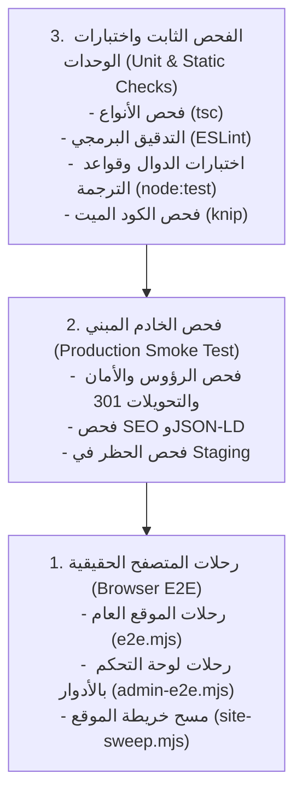

# 11. استراتيجية الجودة والاختبارات الشاملة
## Quality Assurance, Testing Architecture, Matrix & Release Verification Gates

> **المبدأ الهندسي:** لا يُعتبر أي تعديل برمجياً منجزاً لمجرد نجاح البناء (`build passing`). لا تُعتمد أي ميزة إلا بعد اجتياز مصفوفة الاختبارات الآلية والميدانية، وإثبات عدم حدوث أي تراجع في الأداء أو إمكانية الوصول أو صحة الروابط.

---

## 1. هرم ومستويات الاختبار المعتمدة (Testing Pyramid)

---

## 2. مصفوفة الاختبارات التحريرية والفنية (Test Matrix)

| نطاق الاختبار | نوع الاختبار | السيناريوهات المغطاة | الأداة المنفذة | معيار النجاح (Acceptance Criteria) |
|---|---|---|---|---|
| **منشئ الصفحات (Page Builder)** | تكامل ووحدات + E2E | - إنشاء صفحة جديدة وتضمين كتل (Hero, RichText, CardGrid). - تعديل ترتيب الكتل والتأكد من حفظ الترتيب. - التحقق من الحقول الإلزامية ومنع حفظ كتل ناقصة. - حذف كتلة وتحديث الصفحة. | `node:test` + `admin-e2e.mjs` | نجاح الحفظ دون أخطاء، وظهور الكتل في العرض العام بالترتيب المختار. |
| **المعاينة الحية (Live Preview)** | E2E وأمان | - فتح المعاينة لمسودة غير منشورة. - تبديل قياس الشاشة (هاتف 390px / حاسوب 1440px). - التأكد من حظر الزائر المجهول من رابط المعاينة (403/404). - التأكد من وجود رأس `noindex` على صفحة المعاينة. | Puppeteer / `admin-e2e.mjs` | ظهور التعديلات فورياً في المعاينة، ومنع فهرسة المسودة. |
| **الأدوار والصلاحيات (RBAC)** | تكامل وE2E | - تسجيل الدخول بدور مراجع (`reviewer`): الحقول العربية مقفلة للقراءة فقط، وحقول الترجمة قابلة للتعديل. - تسجيل الدخول بدور محرر (`editor`): أزرار الحذف غير ظاهرة. - محاولة ترقية مستخدم من حساب محرر. | `admin-e2e.mjs` | رفض الخادم لأي تعديل غير مصرح به وإرجاع أخطاء صلاحيات دقيقة. |
| **موضع التنقل والقوائم** | تكامل | - نشر صفحة بموضع `primary`: تظهر في القائمة العلوية. - نشر صفحة بموضع `none`: لا تظهر في أي قائمة وتفتح برابطها المباشر. - تغيير ترتيب الصفحة `navOrder`. | `node:test` + `site-sweep.mjs` | ظهور الرابط في الموقع المحدد فقط وبالترتيب الصحيح. |
| **بطاقات المشاركة وSEO** | فحص دلالي | - التحقق من وجود الوسوم: `canonical`, `og:title`, `og:image`, `og:description`. - فحص صحة بيانات Schema.org JSON-LD لكافة النماذج. - فحص الروابط البديلة `hreflang`. | `scripts/seo-audit.mjs` | 0 أخطاء و0 تحذيرات، واكتمال كافة الحقول الدلالية. |
| **إمكانية الوصول الرقمي (A11y)** | آلي وبشري | - فحص كافة الصفحات بمكتبة `axe-core`. - فحص التباين اللوني ونصوص الصور البديلة. - التنقل الكامل في الموقع ولوحة التحكم عبر لوحة المفاتيح (`Tab` / `Shift+Tab`). | `scripts/a11y.mjs` + تدقيق يدوي | 0 مخالفات لمستوى WCAG 2.2 Level AA. |
| **ثنائية الاتجاه (RTL & LTR)** | فحص متصفح | - تصفح الموقع باللغة العربية والتأكد من المحاذاة من اليمين لليسار. - تصفح الموقع باللغة الإنجليزية والتأكد من انقلاب المحاذاة والرموز. - فحص التواريخ المختلطة وعلامات الترقيم. | `admin-e2e.mjs` + فحص يدوي | انسيابية تامة وعدم انكسار التصميم في اللغتين. |
| **تحويل الروابط القديمة (301s)** | فحص شبكي | - اختبار استجابة كافة الروابط القديمة الـ 1,454 والتأكد من إرجاعها `301 Moved Permanently` للمسار الجديد. | `scripts/redirect-matrix.mjs` | نجاح 1,454 فحصاً بنسبة 100% دون أي خطأ 404 أو 500. |

---

## 3. بوابات الإطلاق والاعتماد الإلزامية (Release Verification Gates)

تخضع كل مرحلة برمجية للبوابات الـ 11 الحاكمة التالية قبل إقرار جاهزيتها للدمج أو النشر:

- **البوابة G1 (اعتماد النصوص المؤسسية):** موافقة صريحة من المركز على نصوص «عن المركز»، «الحوكمة»، وشروط الاستخدام.
- **البوابة G2 (تحديث فعاليات 2025-2026):** استلام وتغذية الفعاليات والأنشطة الحديثة لمنع انقطاع الموقع عند عام 2024.
- **البوابة G3 (جودة البيانات):** معالجة المقالات غير المصنفة (142 مقالاً) وإكمال بيانات الكتب وأسماء المؤلفين.
- **البوابة G4 (استقلالية ملفات PDF):** استضافة ملفات الكتب والمجلات الـ 63 محلياً وقطع الارتباط بالخادم القديم.
- **البوابة G5 (الصحة الفنية):** نجاح فحوصات البناء المستقل (`npm run check && npm run smoke`).
- **البوابة G6 (إمكانية الوصول):** اجتياز فحص `axe-core` والتدقيق البشري للوحة المفاتيح.
- **البوابة G7 (الأمان والتحقق الثنائي):** حماية لوحة التحكم بخطوتين وتفعيل ضوابط رفع الملفات ومنع التضمين.
- **البوابة G8 (جاهزية البنية التحتية):** اختبار خطة النسخ الاحتياطي والتراجع على الخادم الجديد.
- **البوابة G9 (خطة الانتقال للنطاق الرسمي):** تفعيل شهادات الأمان وضبط السجلات وتأكيد خريطة التحويلات 301.
- **البوابة G10 (الجاهزية التشغيلية):** تدريب محرري المركز وتوفير دليل تشغيلي محدث.
- **البوابة G11 (التواصل والإعلان):** تجهيز مواد الإطلاق الصحفي والتعريفي المعتمدة من إدارة المركز.
